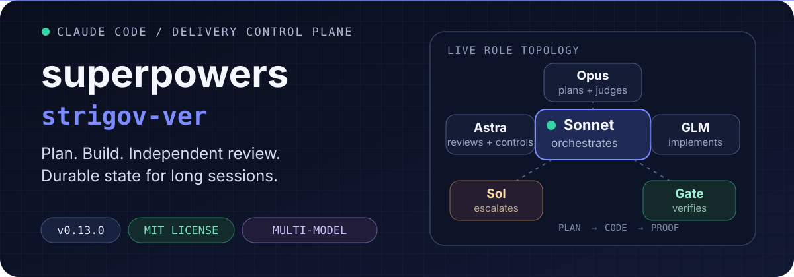
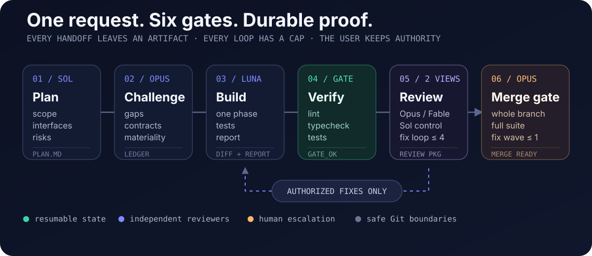

<p align="center">
  
</p>

<p align="center">
  <a href="./README.ru.md"><strong>Читать на русском</strong></a>
  ·
  <a href="#quick-start">Quick start</a>
  ·
  <a href="#delivery-protocol">Protocol</a>
  ·
  <a href="#model-roles">Models</a>
  ·
  <a href="#inside-the-plugin">Contents</a>
</p>

<p align="center">
  
  
  
</p>

`superpowers-strigov-ver` turns Claude Code into a structured software-delivery system. One model orchestrates, specialized models plan and implement, independent reviewers challenge the result, and every important handoff leaves a durable artifact.

> **The outcome:** long implementation tasks can survive context compaction, review loops stay bounded, and code does not reach “done” until phase-level and whole-branch gates are clean.

## Quick start

### 1. Install the prerequisites

You need a recent **Claude Code**, the standalone **Codex CLI**, and a one-time Codex login:

```bash
npm install -g @openai/codex
codex login
```

Only the built-in scheme needs Codex. If you have no OpenAI account, skip it, and before the first pipeline run bind every role whose built-in chain names a Codex profile (`plan-reviewer`, `spec-reviewer`, `implementer`, `implementer.risk`, `implementer.escalation`, `control-review`, `final-review`, `adhoc-review`) to profiles of your own: see [Role routing](#role-routing), the example for someone without OpenAI. `agent-dispatch doctor` then reports the unused Codex profiles as WARN, not FAIL.

Optional — the default implementer, **GLM-5.3-Flash via Z.ai's ZCode**: install [ZCode](https://github.com/zai-org/ZCode) — macOS: ZCode.app into `/Applications`; Linux: see [Linux: ZCode for the GLM channel](#linux-zcode-for-the-glm-channel) below; Windows is not supported yet — then store a GLM Coding Plan API key from <https://z.ai/manage-apikey/apikey-list> once: run `zcode-dispatch api-key set` in a terminal and paste the key at the hidden prompt. The key becomes a provider of ZCode's own "Z.ai Coding Plan" template in the wrapper's private config and does not expire. There is no OAuth login: the CLI's `zcode login` keeps no refresh token and lasts about an hour (details in the `zcode-invocation` skill, "One-time setup"). Without a key, `zcode-dispatch doctor` fails and the pipeline implements on Codex Luna `max` instead — announced, never silent. Behind a local proxy, export `ZCODE_HTTP_PROXY=http://<host>:<port>` if headless runs fail with a network error (the CLI ignores `HTTP(S)_PROXY` and the macOS system proxy; the wrapper passes this variable via the allowlist). The CLI receives an allowlisted environment; explicitly pass extra names with `ZCODE_ENV_PASSTHROUGH="NAME1,NAME2"`.

#### Linux: ZCode for the GLM channel

Z.ai ships an official Linux build of ZCode (beta) on <https://zcode.z.ai> ("All Downloads": `.deb`, `.rpm` and `.AppImage` for x64 and ARM64). The `.deb` and `.rpm` packages install into `/opt/ZCode`, which is where `zcode-dispatch` looks by default. Checked with every official 3.16.2 package (CLI 0.17.0, identical in all six): `.deb` on Debian 12 (arm64 and x64), `.rpm` on Fedora 42, and the extracted `.AppImage` (arm64). In each case `doctor` is ok and a probe reaches Z.ai.

Steps for your agent (Claude Code on the Linux machine):

1. Check the prerequisites: `node --version` (major ≥ 26; the wrapper runs the CLI with the system `node`, not the app's Electron), `flock --version` (util-linux; install it if missing), `git --version`.
2. Install ZCode. Ask the user first: it needs sudo and a download of about 170 MB. Take the link for the machine's architecture (`uname -m`: `x86_64` → x64, `aarch64` → ARM64) from the "All Downloads" section of <https://zcode.z.ai>. Then:
   - Debian/Ubuntu: `sudo apt install ./ZCode-<ver>-linux-<arch>.deb`
   - Fedora/RHEL/openSUSE: `sudo dnf install ./ZCode-<ver>-linux-<arch>.rpm` (or `zypper install`)
   - No sudo: download the `.AppImage`, run `chmod +x ZCode-*.AppImage && ./ZCode-*.AppImage --appimage-extract` in a directory of your choice, and set `"env": { "ZCODE_APP": "<that dir>/squashfs-root" }` in `~/.claude/settings.json` so every `zcode-dispatch` call sees it. (Extraction needs neither FUSE nor sudo. Afterwards `squashfs-root/resources/glm/zcode.cjs` must exist.)
3. Verify. `<root>` below is `/opt/ZCode` for `.deb`/`.rpm`, or `<that dir>/squashfs-root` for the AppImage. `doctor` needs a git work tree, so run it from the repository the pipeline will work in, or pass `--cwd <repo>`:
   - `node <root>/resources/glm/zcode.cjs --version` prints the CLI version;
   - `zcode-dispatch doctor --cwd <repo>` shows `ok platform: linux (config lock: flock(1))` and `ok app: <root> <version>`.

   At this point only `personal-config` and `auth` may fail, because no key is stored yet. `WARN app-version` means the installed version differs from the version the wrapper was verified on, which is fine if the probe in step 4 passes. If the version cannot be read, `doctor` fails `app` instead.
4. Hand the API key step to the user. Never ask for the key in the chat. Give the user one exact command line for their own terminal, with the absolute path of `zcode-dispatch`. For an AppImage install, add a `ZCODE_APP=<root>` prefix, because their shell does not see Claude Code's `settings.json`:

   ```
   /path/to/bin/zcode-dispatch api-key set                                              # .deb / .rpm
   ZCODE_APP=/home/<user>/apps/squashfs-root /path/to/bin/zcode-dispatch api-key set    # AppImage
   ```

   The user runs it and pastes the key at the hidden prompt. Then run `zcode-dispatch doctor --probe --cwd <repo>` (one short request): `probe: ok` means the GLM channel is up.

Notes:
- The package also puts `/usr/bin/zcode` on `PATH`. That is the desktop app's launcher, not the CLI; the wrapper never uses it.
- Do not install third-party ZCode CLI packages (for example `zcode-app-cli` from npm).
- Behind a proxy, export `ZCODE_HTTP_PROXY` (see above).
- Without the official package (for example on an unsupported distribution), copying `resources/{glm,config,app.asar}` from a ZCode install of the same version on macOS (`/Applications/ZCode.app/Contents/Resources`) or Windows into `/opt/ZCode/resources/` also works.

### 2. Install the plugin

Run in Claude Code:

```text
/plugin marketplace add strigov/strigov-cc-plugins
/plugin install superpowers-strigov-ver@strigov-cc-plugins
/reload-plugins
```

The companion runtime is already vendored. OpenAI's separate `codex-plugin-cc` Claude Code plugin is **not** required.

### 3. Ship a real task

```text
/dev Implement resumable uploads with integrity checks
```

The pipeline never starts on its own. Start it with `/dev`, or with `/superpowers-strigov-ver:brainstorming` to settle the design first. To pick an in-progress plan back up in a new session, type `/dev` with no task or just ask to continue: a quiet SessionStart hook names the plan. Inside the pipeline, `dev-orchestrator` triages the task, and trivial single-file edits take a lightweight Sonnet quickfix path.

## What changes

| Default agent workflow | This plugin |
|---|---|
| One model plans, writes, and grades its own work | Different model families write and review each artifact |
| Progress lives mainly in chat context | Plans, ledgers, reports, diffs, and task IDs make progress resumable |
| Review can expand scope or loop indefinitely | Authorization rules, churn detection, and hard round caps bound every loop |
| A green phase can still hide integration failures | A final whole-branch review checks contracts and runs the full suite |

## Delivery protocol

<p align="center">
  
</p>

1. **Plan** — an Opus `xhigh` subagent explores the repository and writes a durable implementation plan with scope, interfaces, global constraints, tests, risks, and an explicit SECURITY/DATA_LOSS tag for every phase.
2. **Challenge** — a fresh Codex Astra `xhigh` review finds material gaps, including missing risk tags; authorized corrections go back to a fresh Opus `high` reviser through the ledger.
3. **Build** — GLM-5.3-Flash `max` implements one phase through Z.ai's own ZCode CLI and writes a report. Codex Luna `max` takes over when the GLM channel is down or switched off; Sol 6.1 `xhigh` implements phases tagged SECURITY/DATA_LOSS from the start and takes over when an Opus diagnosis, a stalled gate or a third blocked review round calls for deeper reasoning.
4. **Verify** — a Sonnet `medium` gate runs lint, typecheck, and affected tests before expensive review begins.
5. **Review twice** — Opus `high` checks spec compliance and quality (`xhigh` on SECURITY/DATA_LOSS phases and in the last round), then a fresh Codex Astra `high` control review probes edge cases, races, security, and regressions.
6. **Gate the branch** — after all phases pass, a fresh Opus `xhigh` review checks the complete branch and full test suite (Astra `xhigh` if Opus is unavailable). One consolidated fix wave is allowed before the final verdict.

Every implementer continuation is addressed by id with `--resume-task` — `task-…` for Codex threads, `zt-…` for ZCode sessions. Reviewers receive a generated package containing the commit list, stat, and contextual diff instead of reconstructing the change from chat history.

## Model roles

Every role runs on a pinned model + effort pair. Claude subagents receive an explicit `effort` on the Agent call (no `ultrathink`); Codex tasks receive explicit `--model` + `--effort`.

| Role | Model · effort |
|---|---|
| Orchestrator (main thread) | Claude Sonnet · `medium` |
| Plan writer / spec writer | Claude Opus · `xhigh` |
| Plan and spec reviser | Claude Opus · `high` |
| Plan and spec reviewer | GPT-6 Astra · `xhigh` |
| Implementer, fix rounds, final fix wave | GLM-5.3-Flash · `max` via Z.ai's ZCode CLI |
| Availability fallback (GLM down or switched off) | GPT-6 Luna · `max` |
| SECURITY/DATA_LOSS phases, reasoning escalation | GPT-6.1 Sol · `xhigh` |
| Frontend implementer | Claude Opus · `high` (new UI) / Claude Sonnet · `medium` (tweaks) |
| Primary code review (4.1) | Claude Opus · `high`; `xhigh` on SECURITY/DATA_LOSS phases and in round 4 |
| Control review (4.2) | GPT-6 Astra · `high` |
| Final whole-branch review | Claude Opus · `xhigh`; GPT-6 Astra · `xhigh` if Opus is unavailable |
| BLOCKED and gate-stall diagnosis, impasse summaries | Claude Opus · `high` |
| Verification gate, synthesis, quickfix, integration check | Claude Sonnet · `medium` |

`max` is reserved for the implementers GLM and Luna (or used when the user asks for it by name); `ultra` is never chosen automatically — only when the user explicitly asks for it. GLM quota: on 2026-10-14 the 1.5× ZCode quota bonus measured inconclusive (expected/measured credits = 3.02 at the standard rate, or 1.51 if the window was off-peak; details in docs/zcode-cli-findings.md).

This table is the built-in scheme: with no `config.json` it is exactly what runs. Any role, the in-session ones included, can be rebound to a profile of your own — see [Role routing](#role-routing).

## Your own harnesses and APIs

`bin/agent-dispatch` binds pipeline roles to **profiles**. A profile is a harness, a way to pay (the harness's own login or an API key), a model and an effort. A role takes a **chain** of profiles: the first is the primary, the others are fallbacks in order. Without a configuration file nothing changes.

`agent-dispatch` ships the routing layer (profiles, keys, `route`, `doctor`, job status, the pass-through to ZCode and Codex) and adapters for `claude -p`, DeepSeek Harness (`dsh`), OpenCode and pi. Any role can run on any profile, the in-session roles included.

`agent-dispatch` lives in the plugin's `bin/`. In your own terminal, call it by its absolute path; Claude can print it for you.

### A profile in three steps

```bash
agent-dispatch preset list                                          # what can be copied
agent-dispatch profile add deepseek-claude --from claude-deepseek   # 1. a profile from a preset
agent-dispatch key set deepseek                                     # 2. the key, at a hidden prompt
agent-dispatch doctor --profile deepseek-claude --probe             # 3. offline checks + one short paid request
```

1. `profile add <name> --from <preset> [--model M] [--key K] [--set k=v]` copies a preset into `config.json`. A preset with a `<…>` placeholder needs it filled by a flag; otherwise nothing is written.
2. Store the key yourself, in your own terminal. `key set <name>` asks for it at a hidden prompt. From a Claude Code session you can pipe it instead: `! pbpaste | agent-dispatch key set <name>`, or on Linux `wl-paste` / `xclip -o -selection clipboard`. A key passed as an argument is refused. A `login` profile uses the harness's own login. For a profile with its own isolated directory, log in there with `agent-dispatch profile env <name> -- <login command>`: `-- opencode auth login`, or `-- claude` and then `/login`, or `-- pi` and then `/login`.
3. `doctor --profile <name>` checks everything that can be checked without a model call. `--probe` adds one short paid request on your key or subscription; you run it, the pipeline never does.

Every preset targets `claude`, `dsh`, OpenCode or pi, and 0.12.0 ships all four adapters, so a profile copied from a preset is ready once `doctor` passes. Profiles on the other harnesses are written by hand: another Codex model or effort, or another Claude model in the session. For example, a cheaper control review and a Sonnet plan writer:

```json
{
  "version": 1,
  "profiles": {
    "astra-medium": { "harness": "codex",  "model": "gpt-6-astra", "effort": "medium" },
    "sonnet-high":  { "harness": "inproc", "model": "sonnet",      "effort": "high" }
  },
  "roles": {
    "control-review": ["astra-medium"],
    "plan-writer":    ["sonnet-high"]
  }
}
```

**Where it lives.** Your profiles and roles are in `~/.claude/plugins/data/superpowers-strigov-ver-agents/config.json`. The directory has mode 0700, and the file holds no secrets: keys sit in `keys/<name>` with mode 0600.

- The file needs `"version": 1`.
- Your profiles are added to the built-in ones. The built-in profiles cannot be redefined: `glm`, `luna`, `sol`, `astra`, `astra-high`, `opus-xhigh`, `opus-high` and `sonnet-medium`. To change one, copy it under a new name.
- A role in the file, `"roles": { "<role>": ["<profile>", …] }`, replaces that role's whole built-in chain. Every other role stays built-in.
- An unknown field, or a role that names a missing profile, is refused with its name, so a typo like `efort` cannot pass silently. A broken file is reported in one `config:` line, and the orchestrator asks you one question.

**Keys from elsewhere.**

- The default, `{"key": "<name>"}`, reads the key from the store above.
- A key already exported in your shell is passed only as `{"keyEnv": "VAR"}`. Without it, the environment allowlist strips the variable.
- A password manager works through `{"keyCmd": [...]}`:
  - macOS: `["security", "find-generic-password", "-w", "-s", "deepseek"]`
  - Linux: `["secret-tool", "lookup", "service", "deepseek"]`
  - any OS: `["op", "read", "op://…"]`

The dispatcher supplies a key through the harness process's environment; it does not put it in argv, settings files or prompts. The pipeline never runs `key set` and never asks you for a key.

The dispatcher passes the resolved key to its background runner through an anonymous pipe, which the runner closes before starting the harness. It creates no key handoff file in the job directory. This does not change the optional `keys/<name>` store or the harness-specific exposure described below: OpenCode's and pi's Bash can still read their harness key.

Profiles that share a key, a harness login (an OpenCode or pi login counts per provider) or a `shares` label drop out together on `auth` or `quota`. The built-in `glm` carries `zai-coding-plan`, so a Z.ai API fallback with that label is not tried against the same exhausted quota.

Each adapter is written against one harness version. Claude Code 2.1.302 itself was run during research, against local stubs ([01](./docs/research/universal-dispatchers/01-claude-code-headless.md)); OpenCode, pi and dsh were not run, and their adapters come from those harnesses' sources and documentation (`skills/agent-invocation`, "Facts from sources"). No adapter has run against a real provider: the tests run on stubs only, so `doctor --probe` on your own key is the first live check. Another version is allowed: `doctor` prints one "not checked" line and does not block the run. The exception is OpenCode 2, which has another CLI: it is refused (`launch`; see [OpenCode](#opencode)). Harness facts in depth: [docs/research/universal-dispatchers/](./docs/research/universal-dispatchers/) and the [design spec](./docs/superpowers/specs/2026-10-20-universal-dispatchers-design.md) (§2–§4).

### Claude Code (`claude -p`)

Install Claude Code itself (`npm install -g @anthropic-ai/claude-code`); the adapter is written against 2.1.302.

| Pays with | Preset | What to know |
|---|---|---|
| Claude subscription (Pro/Max) | `claude-sub` (`opus`, `xhigh`) | Your own `claude` login. Its jobs spend the same subscription limits as your main session ([07 AN4](./docs/research/universal-dispatchers/07-tos-matrix.md)). If a `settings.json` in your login directory sets a key, an endpoint or an `apiKeyHelper`, the profile is refused (`doctor` FAIL `user-settings`). A second account: `"home": "isolated"`, then `agent-dispatch profile env <name> -- claude` and `/login`. |
| API key, Anthropic-compatible endpoint | the table below | `key set <key name>`. The profile runs in its own config directory that holds no claude.ai login, with exactly one key variable. WebSearch and WebFetch are denied. |
| Local model | `claude-local` | No key (`"auth": "none"`); see below. |

Endpoints and environment recipes come from the providers' own Claude Code setups ([06 §1](./docs/research/universal-dispatchers/06-providers-and-plans.md)):

| Preset | Key name | `endpoint` | Model | Preset environment |
|---|---|---|---|---|
| `claude-zai` | `zai` | `https://api.z.ai/api/anthropic` | `glm-5.3[1m]` | `API_TIMEOUT_MS=3000000`, `CLAUDE_CODE_AUTO_COMPACT_WINDOW=1000000`; `shares: zai-coding-plan` |
| `claude-deepseek` | `deepseek` | `https://api.deepseek.com/anthropic` | `deepseek-v4-pro[1m]` | `CLAUDE_CODE_AUTO_COMPACT_WINDOW=786432` |
| `claude-kimi` (Kimi Platform) | `kimi` | `https://api.moonshot.ai/anthropic` | `kimi-k3[1m]` | — |
| `claude-minimax` | `minimax` | `https://api.minimax.io/anthropic` | `MiniMax-M3.1-Flash[1m]` | `CLAUDE_CODE_AUTO_COMPACT_WINDOW=524288` |
| `claude-alibaba` (pay-as-you-go) | `alibaba` | `https://<WorkspaceId>.<region>.maas.aliyuncs.com/apps/anthropic`, `<region>` one of `ap-southeast-1`, `us-east-1`, `eu-central-1`, `ap-northeast-1`, `cn-beijing` | `<model>`, e.g. `qwen3.8-max` | fill the endpoint with `--set endpoint=…` |
| `claude-openrouter` | `openrouter` | `https://openrouter.ai/api` | `<model>` | Bearer key, `ANTHROPIC_API_KEY=""` |

- `[1m]` tells Claude Code the model has a 1M window; for an id it does not know it assumes 200K.
- Z.ai: the key's type decides the billing on this endpoint (Coding Plan or Standard API key) ([06 §1.3](./docs/research/universal-dispatchers/06-providers-and-plans.md)). `shares: zai-coding-plan` is for a Coding Plan key, the quota of the built-in `glm`; drop it for a Standard key with `--set shares=`.
- Kimi Platform allows one request at a time on Tier 0: add `--set maxParallel=1`. `task` enforces `maxParallel` for claude, opencode, pi and dsh profiles; for a codex or zcode profile only the pipeline's parallel tracks respect it, and not as the `SP_IMPLEMENTER` profile (two separate sessions or manual `task` calls are not counted either).
- `effort` goes to `--effort` and to `CLAUDE_CODE_EFFORT_LEVEL`; a `CLAUDE_CODE_EFFORT_LEVEL` in the profile's `env` (some providers' recipes set `max`) overrides the `effort` field.
- Options: `options.tools` (a writer's tool set, by default `Bash,Read,Edit,Write,Glob,Grep`), `options.settings` (merged into the job's `--settings`), `options.maxTurns`.
- A reviewer gets Read, Glob, Grep and the read-only `git show`, `git diff`, `git log`, `git status`. The key never reaches the model's Bash (`CLAUDE_CODE_SUBPROCESS_ENV_SCRUB=1`).

**Local model.** `agent-dispatch profile add local --from claude-local --set endpoint=http://127.0.0.1:<port> --model <id> --set env.CLAUDE_CODE_MAX_CONTEXT_TOKENS=<ctx>`, with the port of your server: llama-server 9931, LM Studio 1234, Ollama 11434 ([08 §3](./docs/research/universal-dispatchers/08-local-models.md)). The preset runs one job at a time (`maxParallel: 1`), raises Claude Code's stream idle timeouts for a long prefill and turns off the attribution block, which would otherwise keep the server from reusing its prompt cache across jobs.

- `<ctx>` is the context the server really gives one request (leave that `--set` out to keep the preset's 131072); llama-server's `GET /props` shows `n_ctx` and the slot count. To change it later, edit the profile's `env` in `config.json`: `profile add` refuses a name that already exists.
- Ollama's default context is 4k on a GPU with less than 24 GB, and what does not fit is dropped silently. Raise it with `OLLAMA_CONTEXT_LENGTH` (Ollama advises at least 64k for coding tools).
- Memory: on 16 GB a local model is no implementer; on 32–48 GB it can take small, well-specified phases. Never SECURITY/DATA_LOSS phases, planning or a blocking review ([08 §9](./docs/research/universal-dispatchers/08-local-models.md)). Routing is per role, not per phase: no route sends only the small phases to one profile, and `"implementer": ["local"]` (or `SP_IMPLEMENTER=local`) hands the local model every phase, fix round and final fix wave of that role. So put it last in the `implementer` chain, as a fallback when the cloud channels are down or out of quota, or on `quickfix` (trivial single-file edits). Never first in `implementer`, and never on `implementer.risk`, `implementer.escalation`, `plan-writer`, `plan-reviser`, `gate` or a reviewer role.

### OpenCode

| | |
|---|---|
| Install | `npm i -g opencode-ai@1.19.3`, or `brew install anomalyco/tap/opencode`. Not `brew install opencode`: that is OpenCode 2, which the adapter refuses with a hint to install v1. Supported: 1.19.x |
| Login | Preset `opencode-login` (`"auth": "login"`): `opencode auth login` → GitHub Copilot, ChatGPT Plus/Pro, OpenCode Go or GLM Coding Plan (providers `github-copilot`, `openai`, `opencode-go`, `zai-coding-plan`); the model is `--model <provider>/<model>`. A GLM Coding Plan login spends the quota of the built-in `glm`: add `--set shares=zai-coding-plan`, so the profile drops out with `glm` on `auth` or `quota` |
| Key | Preset `opencode-key`: `--key <name> --set keyVar=<VAR>`: `ZHIPU_API_KEY` for `zai-coding-plan`, `DEEPSEEK_API_KEY` for `deepseek`, `MINIMAX_API_KEY` for `minimax`. A Coding Plan key on `zai-coding-plan` spends the same quota: add `--set shares=zai-coding-plan` as well (not for a Standard key) |
| Model, effort | `<provider>/<model>`, the ids `opencode models <provider>` prints; `effort` → `--variant` |
| Home | A login profile uses your own OpenCode directories. A keyed profile gets its own, `homes/<profile>/`, which must hold no saved login (`data/opencode/auth.json` would win over the key: `doctor` FAIL, the task refused). A login of its own (a second account): `"home": "isolated"`, then `agent-dispatch profile env <name> -- opencode auth login`. Whatever the isolation, OpenCode also reads `~/.opencode/opencode.json` and `opencode.jsonc` in your real home, and the same two files in the machine's managed config directory (`/Library/Application Support/opencode` on macOS, `/etc/opencode` on Linux). For a keyed profile they are read as JSONC (comments and trailing commas are fine), and the `provider.<its provider>` entry there (every entry if the model names no provider) is checked: a field that would override its key or send its requests elsewhere refuses the profile (`doctor` FAIL `home`, the task refused), and the message names the field, never its value. Such fields are any field of the entry except `name`, `whitelist`, `blacklist`, `models` and `options` (`npm`, `api`, `env`, and also an `id` or `doc` kept from a copied catalog entry); any `options` key except `timeout`, `chunkTimeout` and `setCacheKey` (`apiKey`, `baseURL`, `headers` and the like); and, in a model under `models`, its `provider` and `headers`, or `apiKey`, `baseURL` or `headers` in its `options` or `variants`. A harmless entry (empty, a `name`, `whitelist`/`blacklist`, timeouts, model limits and reasoning variants) and a file without that entry run. Remove the field. Only an endpoint setting with no credential (`baseURL`, `api`, `npm`) may move into `homes/<profile>/config/opencode/opencode.json`: OpenCode reads that file too, and an `apiKey`, a header or `env` there would override the key just the same (the key comes in through `keyVar`), and the adapter does not check that file. In the managed directory its administrator does that. A file there that does not parse even as JSONC (an empty file is skipped: OpenCode reads it as `{}`), or that has a top-level key whose name holds `{env:…}` or `{file:…}` (OpenCode fills them in before parsing, so the key could become `provider`; the message names the key, and the variable or file is not read), cannot be checked, so it refuses the profile too. The macOS MDM profile `ai.opencode.managed` is not checked |
| Options | `options.permission`: extra OpenCode permission rules — all of them for a writer, only the `deny` ones for a reviewer. `options.plugins: true` loads your external OpenCode plugins (off by default: `OPENCODE_PURE=1`) |
| Reviewer | Its own read-only agent: read, grep, glob, list and `git show/diff/log/status`. No edits, no other commands, no web, no `.env` files, nothing outside the repository but the temp directories |
| Who sees the key | OpenCode's bash sees it (see [Sandbox](#sandbox-optional)); OpenCode's own session store keeps what its bash printed |

### pi

| | |
|---|---|
| Install | `npm i -g --ignore-scripts @earendil-works/pi-coding-agent@1.3.0` (Node ≥ 22.19). Supported: 1.3.x. pi's find and grep need `fd` and `rg` on `PATH` (the adapter keeps pi offline, so it does not download them; `doctor` checks) |
| Key | Preset `pi-key`: `--key <name> --set keyVar=<VAR>`: `ZAI_API_KEY` for `zai`, `DEEPSEEK_API_KEY` for `deepseek`, `OPENROUTER_API_KEY` for `openrouter`. Model `<provider>/<id>`; `effort` → `--thinking`. pi's `zai` is Z.ai's Coding Plan endpoint: with a Coding Plan key add `--set shares=zai-coding-plan` (the quota of the built-in `glm`), so the profile drops out with `glm` on `auth` or `quota`; a Standard key there is billed pay-as-you-go |
| Login | "Sign in with ChatGPT": `"auth": "login"`, then `/login` in pi's TUI (in your own pi directory, or with `"home": "isolated"` through `agent-dispatch profile env <name> -- pi`). pi's Anthropic and Copilot logins get no preset: there pi presents itself as another client |
| Home | A keyed profile runs in `homes/<profile>/pi` (`agent-dispatch profile env <name>` prints it as `PI_CODING_AGENT_DIR`). A saved login there (`auth.json`) would win over the key, so the profile is refused |
| Own endpoint | A `models.json` in that directory whose `apiKey` is `"$<keyVar>"` or `"${<keyVar>}"`, so the key still comes from the store. Any other `apiKey` there for the profile's provider (for every provider when `model` names none) — a literal key, a `!command`, another variable — would win over `keyVar`: `task` refuses the profile (exit 2) and `doctor` FAILs `pi-auth` (with `--probe`, before any request), as for a `models.json` that is not a JSON object or is a symlink. The same goes for a credential header (`Authorization`, `x-api-key`, `api-key`, a token or a secret) in the provider's `headers`, in `models[].headers` or in `modelOverrides`: only `"$<keyVar>"` / `"${<keyVar>}"` is allowed there, optionally after `Bearer `, and a header set to a `!command` or another variable is refused too. A provider entry without `apiKey` runs. Format: [03 §5.3](./docs/research/universal-dispatchers/03-pi.md) |
| Options | `options.extensions`: one `-e` each, e.g. `["builtin:llama.cpp", "<path>"]`; pi's built-ins are `builtin:mcp`, `builtin:llama.cpp`, `builtin:codemode`, `builtin:tool-search` |
| Reviewer | `read,grep,find,ls` — **no bash, so no git**: the review package is its only view of the diff |
| Who sees the key | pi's bash sees it (see [Sandbox](#sandbox-optional)). pi's session files are rewritten with the key redacted when the runner finishes the job: completed, failed, cancelled or timed out. If the runner process itself dies (killed, a crash, a power loss), the job is reaped as `failed` / `crash` and those files stay unredacted in the private (0700) data directory that also holds the key store; to remove them, delete the job's directory `~/.claude/plugins/data/superpowers-strigov-ver-agents/state/<workspace>/jobs/<id>/` (`<workspace>` is the folder name of the work tree the job ran in, a hyphen and 8 hex digits; a parallel track's worktree `<repo>-wt-<phase>` has its own, with its own job numbers). A resumed job keeps its session files in the directory of its chain's first job, the one started without `--resume-task`: delete `jobs/<id>/` of each job of the chain (the ids passed to `--resume-task`, back to the first). Do not take the directory from the dead job's own record: it was closed as the job left it, and the job may have rewritten it, `meta.sessionDir` included. While that tree exists, `agent-dispatch status <the id it resumed> --cwd <tree> --json` shows the chain's directory as the parent of `job.meta.sessionDir`; that is only a hint, as a job may rewrite that record too, so trust it only when it is `<that jobs directory>/<an id of this chain>/sessions` |

A `models.json` for an endpoint of your own, with the profile's `"keyVar": "MY_KEY"` and `"model": "<provider>/<id>"`:

```json
{ "providers": { "<provider>": { "baseUrl": "<url>", "api": "openai-completions", "apiKey": "$MY_KEY", "models": [{ "id": "<id>" }] } } }
```

### DeepSeek Harness (`dsh`)

| | |
|---|---|
| Install | `npm i -g @deepseek-ai/dsh@0.2.1-rc.2` (Node `^22.19` or `>=24`). Homebrew's `dsh` is another program, which the adapter refuses. Supported: 0.2.x |
| Key | DeepSeek has no subscription, and dsh no login. Preset `dsh-deepseek`: `key set deepseek` (it goes to `DEEPSEEK_API_KEY`). Or `"auth": "native"`: `DEEPSEEK_API_KEY=…` in `$DSH_HOME/.env` (default `~/.dsh/.env`) — but dsh reads a `.env` in the repository first, and a key there overrides yours (`doctor` warns) |
| Home | `"home": "user"` (default): `$DSH_HOME` or `~/.dsh`. `"isolated"`: `homes/<profile>/dsh` (`agent-dispatch profile env <name>` prints its `DSH_HOME`) |
| Model, effort | `deepseek-v4-pro` (the preset) or `deepseek-flash` (dsh's own default); effort `off`, `low`, `high` (default) or `max` |
| Endpoint | `endpoint` is dsh's `baseURL` (default `https://api.deepseek.com/anthropic`), e.g. your own gateway; a repository `.env` cannot change it |
| Options | `options.sessionLog: true` turns dsh's session-log upload back on (off by default). `options.agentsHome: "user"` lets dsh read the shared `~/.agents`. `options.patch` adds rows to dsh's patch file; the key variable, `baseURL` and the permission rows stay the adapter's |
| Reviewer | Requests dsh's `read-only` OS sandbox. Before each reviewer or native-writer launch, including resume and probe, the adapter requires an offline `--dump-config` to confirm resolved sandbox and approval policies; incompatible or unverified policies prevent launch. This checks configuration, not the OS sandbox's implementation. A writer without `native` runs in `danger-full-access` |
| Who sees the key | dsh strips `*KEY*` and `*TOKEN*` variables from its tools |

### ZCode and Codex

- **ZCode** (`glm`): set up as in [Quick start](#1-install-the-prerequisites) and [Linux: ZCode for the GLM channel](#linux-zcode-for-the-glm-channel). The profile passes through to `zcode-dispatch` unchanged; the wrapper pins the model.
- **Codex** (`luna`, `sol`, `astra`, `astra-high` and your own `codex` profiles): `codex login`, as in [Quick start](#1-install-the-prerequisites); the profile passes through to `codex-dispatch`. Only OpenAI models are documented here: third-party providers in Codex's own configuration are neither documented nor supported.

### Role routing

| Role (name in `config.json`) | Where in the pipeline | Default | Runs by default |
|---|---|---|---|
| `plan-writer` | plan writer | `opus-xhigh` | in the session (Agent tool) |
| `plan-reviser` | plan revisions | `opus-high` | in the session |
| `plan-reviewer` | plan review (loop up to 4) | `astra` | external harness |
| `spec-reviewer` | spec review in brainstorming | `astra` | external harness |
| `implementer` | non-frontend phases, fix, gate-fix, final fix wave, integration repair | `glm`, `luna` | external harness |
| `implementer.risk` | SECURITY/DATA_LOSS phases | `sol` | external harness |
| `implementer.escalation` | escalation to deeper reasoning | `sol` | external harness |
| `frontend.new-ui` | frontend phases with new UI | `opus-high` | in the session |
| `frontend.tweak` | tweaks to existing frontend | `sonnet-medium` | in the session |
| `gate` | lint, typecheck, affected tests | `sonnet-medium` | in the session |
| `phase-review` | phase review 4.1 | `opus-high` | in the session |
| `phase-review.escalated` | phase review 4.1 on risk-marked phases and in round 4 | `opus-xhigh` | in the session |
| `control-review` | control review 4.2 | `astra-high` | external harness |
| `synthesis` | review synthesis | `sonnet-medium` | in the session |
| `final-review` | final whole-branch review | `opus-xhigh`, `astra` | in the session, then external |
| `diagnosis` | BLOCKED, stalled gate | `opus-high` | in the session |
| `quickfix` | trivial edits | `sonnet-medium` | in the session |
| `integration-check` | parallel-group integration check | `sonnet-medium` | in the session |
| `adhoc-review` | `requesting-code-review`, the second opinion in `systematic-debugging` | `astra-high` | external harness |

`frontend.new-ui` and `frontend.tweak` are two roles, not a chain: triage picks one, as before.

An example for someone without OpenAI:

```json
"roles": {
  "implementer":            ["glm", "deepseek-dsh"],
  "implementer.risk":       ["claude-sub"],
  "implementer.escalation": ["claude-sub"],
  "plan-reviewer":          ["deepseek-claude", "oc-copilot"],
  "spec-reviewer":          ["deepseek-claude"],
  "control-review":         ["deepseek-claude", "glm-api"],
  "final-review":           ["opus-xhigh", "deepseek-claude"],
  "adhoc-review":           ["deepseek-claude"]
}
```

- When GLM fails, a phase goes to `deepseek-dsh` instead of Luna.
- Risk-marked phases and escalations run on Opus through the Claude subscription.
- Reviewers run on DeepSeek, with Copilot and the GLM API as fallbacks.

Its profiles come from the presets above; `deepseek-claude` is the one from [A profile in three steps](#a-profile-in-three-steps):

```bash
agent-dispatch profile add deepseek-dsh --from dsh-deepseek   # the same key, deepseek
agent-dispatch profile add claude-sub   --from claude-sub
agent-dispatch profile add oc-copilot   --from opencode-login --model github-copilot/<model>   # ids: opencode models github-copilot
agent-dispatch profile add glm-api      --from claude-zai     # key set zai
```

More about routing:

- **In-session roles.** These roles can be bound to any profile, like the others. An `inproc` profile runs them in the session on another Claude model or effort: on Claude Pro, for example, define `"sonnet-high": { "harness": "inproc", "model": "sonnet", "effort": "high" }` and set `"plan-writer": ["sonnet-high"]`. Any other profile runs them as a background job on its harness: the roles that write files or run the project's tests get write access (the gate, the phase reviews and the integration check must still leave the files alone — the orchestrator compares the working tree before and after, and asks you once if anything changed), while `diagnosis` and `final-review` run read-only. ZCode (`glm`) has no read-only mode: a read-only role there — these two or a reviewer (`plan-reviewer`, `spec-reviewer`, `control-review`, `adhoc-review`) — gets write access (`route` warns), and the same before/after check runs; the built-in chains never put one there. On a profile with the sandbox off, write access is full access, as for an implementer ([Sandbox](#sandbox-optional)), and the check sees only the working tree. If your tests leave files that are not in `.gitignore`, add them there. On an external profile `frontend.*` gets a short design brief instead of the `frontend-design` skill. The built-in chains start in the session, so without `config.json` nothing changes; `route --all` lists every role whose chain differs, `"final-review": ["astra"]` included.
- **How the pipeline reads routes.**
  - At start and after a compaction, the orchestrator runs `agent-dispatch route --all`. The answer `routes: default` is not announced. Otherwise you get one line with your differences.
  - Before every dispatch of a reviewer or an in-session role (the plan writer, the gate, diagnosis and the rest), at a phase's first implementer dispatch and at every switch it runs `route <role>`, so nothing has to be remembered. A phase's retries and fix rounds stay on its current profile.
  - After `routes: default` these calls are skipped and the built-in scheme answers.
  - A switch to the next profile in a chain is one announced line, for example `Channel implementer: glm-api → deepseek-dsh (glm-api: quota).` Switches between built-in profiles keep their old lines, such as `GLM channel failed … falls back to Luna max`.
- **Kill switch.**
  - "без GLM" and "через Luna" work as before.
  - With your own routing (`route --all` does not print `routes: default`), "без <profile>" drops any profile from every chain until the session ends; with the built-in scheme only "без GLM" and "через Luna" work, as before. With the example above, "без GLM" sends every phase, risk-marked ones included, to `deepseek-dsh`.
  - `SP_IMPLEMENTER=luna` works as before. `SP_IMPLEMENTER=<profile>`, where the profile is one you defined in `config.json` and it runs outside the session, makes that profile the implementer for every non-frontend phase and turns GLM off; when it fails, the pipeline asks you instead of moving on. `SP_IMPLEMENTER=glm` names the default and changes nothing. Any other value is ignored, as before: a built-in name such as `sol` (to make Sol the implementer, write `"implementer": ["sol"]` in `config.json`), an unknown name, an in-session profile. GLM stays on. Without profiles of your own nothing is announced; with them you get one line of notice at start.
- **Family rule.** In the built-in scheme the writer and the reviewer of an artifact come from different model families. `agent-dispatch` does not check your routing for this. Keep each reviewer in a different family from the plan writer and the implementer.

### Sandbox (optional)

`sandbox` and `wrap` are fields of `claude`, `opencode`, `pi` and `dsh` profiles only; `doctor` checks both. The sandbox is off by default (`"sandbox": "off"`): a writer then runs with full access (claude `bypassPermissions`, dsh `danger-full-access`), as ZCode runs `--mode yolo`.

| Harness | `"sandbox": "native"` |
|---|---|
| `claude` | Claude Code's sandbox for Bash; a writer runs with `acceptEdits` (edits in the repository only). Bash has no network until you add domains to `sandbox.network.allowedDomains` through `options.settings`. Needs `/usr/bin/sandbox-exec` on macOS, `bubblewrap` and `socat` on Linux |
| `dsh` | `workspace-write`: writes only in the repository and the temp directories. In a linked git worktree (a parallel track) `git commit` may be denied, since its git metadata lies outside (not verified); if it is, keep parallel tracks off dsh |
| `opencode`, `pi` | No sandbox of their own: `native` does nothing (`doctor` says so). Use `wrap` |

`codex` and `zcode` profiles take neither field (with one, `config.json` is refused): Codex always runs in its own sandbox, `workspace-write` with `--write` and read-only without it; ZCode always runs `--mode yolo`.

**`wrap`** is an argv prefix for the harness command, for example Anthropic's sandbox-runtime `srt` (`@anthropic-ai/sandbox-runtime`, a beta) or a container. Install `srt` globally (`npm i -g @anthropic-ai/sandbox-runtime`; Node ≥ 22.12, on Linux also `bwrap`, `socat`, `rg`), never inside a repository the pipeline works in: a copy there can be rewritten from inside the sandbox. A pi profile under `srt`, and a sketch of its settings ([09 §7.3](./docs/research/universal-dispatchers/09-sandboxing-and-credentials.md); not run — the full key list is in §2.3):

```json
"pi-deepseek": { "harness": "pi", "auth": { "key": "deepseek" }, "keyVar": "DEEPSEEK_API_KEY", "model": "deepseek/<id>",
                 "wrap": ["srt", "--settings", "/Users/me/.config/srt/pi.json", "--"] }
```

```json
{
  "network": { "allowedDomains": ["api.deepseek.com:443"], "strictAllowlist": true, "allowLocalBinding": false },
  "filesystem": {
    "denyRead": ["~/.ssh", "~/.aws", "~/.config/gh", "~/.config/gcloud", "~/.azure", "~/.kube", "~/.docker",
                 "~/.netrc", "~/.git-credentials", "~/.npmrc", "~/.pypirc", "~/.codex", "~/.zcode", "~/.pi", "~/.dsh",
                 "~/.local/share/opencode", "~/.claude", "~/.claude.json", "~/Library/Keychains"],
    "allowRead": ["~/.claude/plugins/data/superpowers-strigov-ver-agents/state",
                  "~/.claude/plugins/data/superpowers-strigov-ver-agents/homes/pi-deepseek"],
    "allowWrite": ["<repository>", "~/.claude/plugins/data/superpowers-strigov-ver-agents/state",
                   "~/.claude/plugins/data/superpowers-strigov-ver-agents/homes/pi-deepseek"]
  }
}
```

`allowRead` and `allowWrite` open only two places in the plugin's data directory: `state/` (pi writes its session files to `state/<workspace>/jobs/<id>/sessions`) and this profile's home `homes/<profile>/`; `denyRead` closes the rest of `~/.claude`. Never open the whole data directory: `keys/` holds every stored key, the other profiles' homes hold their logins, and a job that can write `config.json` can drop its own `wrap` or add a `keyCmd` that runs outside the sandbox. `agent-dispatch` reads the key outside the sandbox, always as `config.json` names it. A resumed job runs on the profile as `config.json` has it now (its `env`, `bin`, `wrap` and `sandbox`), never on the copy in the job's record, and `--resume-task` refuses (`dispatch --fresh`) a record whose harness, model, endpoint, home, `bin`, `wrap`, `sandbox`, `auth`, `keyVar` or `authHeader` differ from `config.json`. So a job that rewrites its own record can neither take the sandbox off the next run of its session nor slip its own environment (`NODE_OPTIONS`, `PATH`) into it. A gap remains: `state/` also holds the other jobs' records, so a hostile job with write access there could rewrite a record about to start. Key handoff no longer creates a file in that shared directory. Treat `srt` here as containment for a careless model, not as a boundary against a hostile one.

The before/after no-edit check uses Git snapshots and rereads present tracked paths despite `assume-unchanged` or `skip-worktree`, without changing the real Git index. Git filters and normalization still apply. It does not certify the staging index, refs, Git configuration, ignored files, `.superpowers/` or paths outside the tree. Use filesystem and network isolation to enforce access boundaries.

- macOS cannot nest one Seatbelt sandbox in another. Under `srt`, `claude` runs only with `"sandbox": "off"`, and `dsh` only as a writer without `native` (`danger-full-access`: its reviewer mode is a sandbox too).
- `srt` exits 0 when the harness dies of SIGINT or SIGTERM. A job's outcome comes from its own record, never from that exit code.
- A local model under `srt` needs `"127.0.0.1:<port>"` in `allowedDomains` and an empty `NO_PROXY` inside the sandbox: `srt` sets `NO_PROXY=localhost,127.0.0.1,…`, and on macOS the sandbox reaches loopback only on `srt`'s proxy ports. For example, end `wrap` with `"env", "NO_PROXY=", "no_proxy="`. Whether the harness's HTTP client then sends a plain-`http://` request to loopback through `srt`'s proxy was not verified ([09 §6](./docs/research/universal-dispatchers/09-sandboxing-and-credentials.md), rule 4; §10, item 5).
- On macOS keep `allowLocalBinding: false`. `true` opens every localhost port, a local proxy's included (a TUN or VPN client's), and the egress allowlist no longer holds.
- `SANDBOX_RUNTIME=1` in the environment means `agent-dispatch` itself already runs inside `srt` (in a sandboxed Claude Code Bash, for example): a nested Seatbelt does not start.
- Who sees the key: `claude` hides it from the model's Bash, `dsh` strips it from its tools, but OpenCode's and pi's bash see it. Under `srt`, `credentials.envVars` with `"mode": "mask"` (plus the experimental `network.tlsTerminate`) gives the harness a stand-in instead; where that still leaks: [09 §2.4](./docs/research/universal-dispatchers/09-sandboxing-and-credentials.md).

### What providers allow — for reference, as of 2026-10-20; your responsibility

| Subscription / key | Officially allowed | Grey zone | Not allowed |
|---|---|---|---|
| Claude Pro/Max | Claude Code, including `claude -p` [AN1, AN4] | — | OAuth in third-party harnesses (OpenCode, pi and others) |
| ChatGPT Plus/Pro | Codex; OpenCode, pi ("Sign in with ChatGPT"), Kilo [OA1, OA6] | harnesses OpenAI does not name | ChatGPT Business/Enterprise in third-party harnesses |
| GLM Coding Plan | ZCode, Claude Code, Codex, OpenCode, pi, Crush, Kilo, Cline | — | tools missing from Z.ai's list (Qwen Code, Kimi CLI, dsh) |
| GitHub Copilot | OpenCode [GH1] | Crush, Kilo, Cline | pi's login (pi presents itself as VS Code) |
| OpenCode Go | Claude Code, Codex, ZCode, pi, OpenCode, Kilo | — | — |
| OpenCode Zen | OpenCode | outside OpenCode | — |
| Kimi Code | interactive use | headless runs (Kimi's terms say interactive only, although the CLI docs show `kimi -p`) | — |
| MiniMax M Plan | any compatible tool | headless runs (the plan is meant for interactive use) | — |
| Alibaba Coding Plan | interactive use | — | headless runs [AL1] |
| Alibaba / QwenCloud Token Plan | — | headless runs | — |
| Google AI (Gemini, Antigravity) | Google's tools | — | OAuth in third-party harnesses; running `agy` from a third-party harness |
| Ollama Cloud | — | automation (not explicitly allowed by the terms) | — |
| Any pay-as-you-go key (DeepSeek, Z.ai Standard, Kimi Platform, MiniMax API, Alibaba PAYG, OpenRouter) | any harness | — | — |
| Local model | any harness | — | — |

`claude -p` with a third-party endpoint does not breach Anthropic's terms, but Anthropic does not support that configuration.

The source IDs in brackets refer to [docs/research/universal-dispatchers/07-tos-matrix.md](./docs/research/universal-dispatchers/07-tos-matrix.md).

### If something breaks

Collect three things and attach them to an issue or a message to the owner:

- the output of `agent-dispatch doctor --profile <p>`;
- the output of `agent-dispatch status <id> --json`;
- the job log, `state/<workspace>/jobs/<id>.log` in the data directory above. Secrets are redacted in it.

If an endpoint rejects the request's beta fields, add `CLAUDE_CODE_DISABLE_EXPERIMENTAL_BETAS=1` to the profile's `env`.

## Guardrails

- **Manual start** — pipeline skills carry `disable-model-invocation: true`: the model neither sees nor loads them on its own. They run only after you start them, chain into each other by reading `SKILL.md` files, and resume an in-progress plan only when you ask to continue. The discipline skills (`systematic-debugging`, `test-driven-development`, `verification-before-completion`, `receiving-code-review`) still trigger automatically.
- **Independent judgment** — the writer and reviewer of an artifact come from different model families.
- **Authorization ledger** — review feedback is triaged before a fixer receives it; scope expansion is never silently implemented.
- **Bounded loops** — plan and phase reviews cap at four rounds; final whole-branch review caps at two.
- **No review ping-pong** — rejected findings cannot return unchanged, identical blocker lists escalate, and late low-materiality churn cannot keep a converged loop alive.
- **Human authority** — plan conflicts, material scope changes, and unresolved impasses return to the user.
- **Safe Git** — no `--no-verify`, no amend, no force push, and no push without explicit approval in the current session.
- **Isolated parallelism** — plan-marked independent phases may run in separate worktrees, with a hard concurrency width of two.
- **Terms-respecting GLM access** — GLM is reached only through Z.ai's own ZCode CLI with truthful client identification; no raw API, no token extraction; GLM never receives SECURITY / DATA_LOSS phases and runs unsandboxed only inside a git tree under the preamble's restrictions.

## Inside the plugin

### Fork-specific capabilities

| Component | Purpose |
|---|---|
| `dev-orchestrator` | Complete planning, implementation, verification, review, commit, and resume protocol |
| `codex-invocation` | Reliable background Codex dispatch through the vendored companion runtime |
| `zcode-invocation` | Background GLM-5.3-Flash dispatch through Z.ai's ZCode CLI: setup, doctor/probe, Monitor loop, failure handling |
| `agent-invocation` | Role routing through `agent-dispatch` profiles: `route`, jobs by id prefix, failure classes, headless preambles |
| `architecture-memory` | Compact persistent architecture map in `docs/ARCHI.md` |
| `/dev` | Explicit entry point for the full delivery protocol; with no task, resumes an in-progress plan |
| `bin/pipeline-context` | SessionStart hook: names an in-progress plan and the skill to re-read after compaction, otherwise silent |
| `bin/review-package` | Generates reviewer-ready commit and diff packages |
| `bin/sdd-workspace` | Resolves isolated per-plan scratch workspaces |
| `bin/zcode-dispatch` | ZCode CLI job wrapper: task/status/result/cancel/release-stale/doctor/api-key with pinned model, mode and client identification; `release-stale` frees a workspace reservation left by a crashed job, after verifying it is dead |
| `bin/agent-dispatch` | Profiles, keys and role routes (`route`, `channels`, `doctor`); one `status` across ZCode, Codex and its own jobs; pass-through to `zcode-dispatch` and `codex-dispatch` |

### Adapted Superpowers skills

`brainstorming`, `dispatching-parallel-agents`, `executing-plans`, `finishing-a-development-branch`, `receiving-code-review`, `requesting-code-review`, `systematic-debugging`, `test-driven-development`, `using-git-worktrees`, `verification-before-completion`, `writing-plans`, and `writing-skills`.

The upstream `subagent-driven-development` skill is replaced by `dev-orchestrator`. The aggressive `using-superpowers` injection and its SessionStart hook are intentionally not included; the plugin's own SessionStart hook speaks only when a plan is in progress or a pipeline skill needs re-reading after compaction.

<details>
<summary><strong>Repository map</strong></summary>

```text
.
├── .claude-plugin/plugin.json       # Plugin manifest and source version
├── commands/dev.md                  # /dev command entry point
├── hooks/hooks.json                 # SessionStart → bin/pipeline-context
├── bin/
│   ├── agent-dispatch               # Profiles, keys, role routes, job dispatch
│   ├── codex-dispatch               # Vendored companion wrapper
│   ├── pipeline-context             # In-progress plan / re-read hint for the session
│   ├── review-package               # Reviewer-ready diff package generator
│   ├── sdd-workspace                # Per-plan scratch workspace resolver
│   ├── zcode-dispatch               # ZCode CLI job wrapper (shim)
│   ├── lib/zcode-dispatch.mjs       # ZCode job runner, records, doctor
│   ├── lib/agent-core.mjs           # Shared job core for agent-dispatch
│   ├── lib/agent-dispatch.mjs       # agent-dispatch CLI, config, routes
│   ├── lib/agents-defaults.json     # Built-in profiles, roles, presets
│   └── lib/adapters/                # Harness adapters
├── skills/
│   ├── dev-orchestrator/            # Protocol and role prompt templates
│   ├── agent-invocation/
│   ├── codex-invocation/
│   ├── zcode-invocation/
│   ├── architecture-memory/
│   └── ...                          # Adapted Superpowers skills
├── tests/test-sdd-scripts.sh        # Workspace/package integration tests
├── tests/test-pipeline-context.sh   # SessionStart hook + manual-only skill checks
├── tests/test-zcode-dispatch.sh     # ZCode wrapper tests (stubbed CLI)
├── tests/test-agent-core.sh         # Job core tests (trivial adapter)
├── tests/test-agent-dispatch.sh     # agent-dispatch tests (stubbed wrappers)
├── tests/test-adapter-*.sh          # Harness adapter tests (stubbed harnesses)
├── tests/test-orchestrator-defaults.sh  # Built-in roles, commands and caps unchanged
└── vendor/codex-companion/          # Vendored OpenAI companion runtime
```

</details>

<details>
<summary><strong>Vendored Codex companion</strong></summary>

All Codex calls go through `bin/codex-dispatch`. The wrapper works from a marketplace installation or local checkout and isolates state under `~/.claude/plugins/data/superpowers-strigov-ver-codex`.

The upstream base is recorded in `vendor/codex-companion/VERSION`. Local patches add thread-addressed resume, GPT-6 `max`/`ultra` reasoning efforts, broker cleanup, and optional review-authorization fields.

</details>

## Development and releases

Run the test suites:

```bash
bash tests/test-sdd-scripts.sh
bash tests/test-pipeline-context.sh
bash tests/test-zcode-dispatch.sh
bash tests/test-agent-core.sh
bash tests/test-agent-dispatch.sh
for t in claude opencode pi dsh; do bash tests/test-adapter-$t.sh; done
bash tests/test-orchestrator-defaults.sh
```

For a release, synchronize the version in `.claude-plugin/plugin.json`, both README files, `PLUGIN_README.md`, and the plugin entry in the external [`strigov-cc-plugins` marketplace catalog](https://github.com/strigov/strigov-cc-plugins). Updating this repository alone does not publish a marketplace release.

## Provenance

- [Superpowers](https://github.com/obra/superpowers) by Jesse Vincent / obra — MIT. This fork includes adapted v5.0.7 skills and selected source-verified mechanisms from Superpowers 6 v6.1.1.
- [TRIP-workflow](https://github.com/PiLastDigit/TRIP-workflow) by PiLastDigit — MIT. Thread-addressed resume, verification gates, review synthesis, the ad-hoc consultation template, and architecture-memory concepts were adapted from this project.
- The vendored Codex companion originates from OpenAI's `codex-plugin-cc` and retains its Apache-2.0 license.

## License

Original work in this repository is released under the [MIT License](./LICENSE). Vendored components retain their respective licenses.
