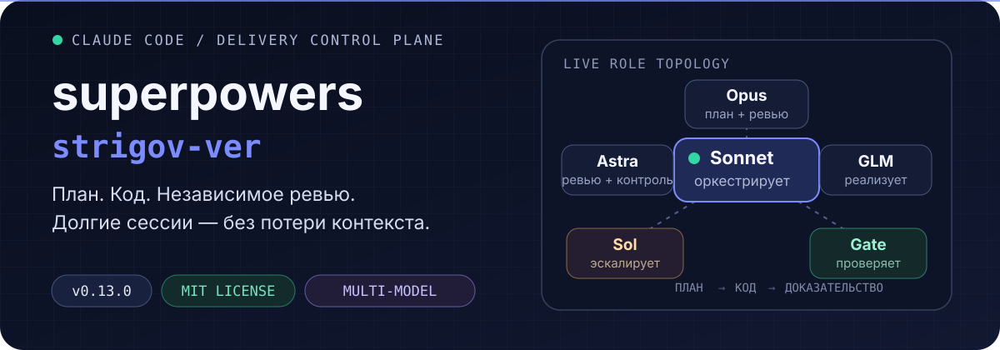
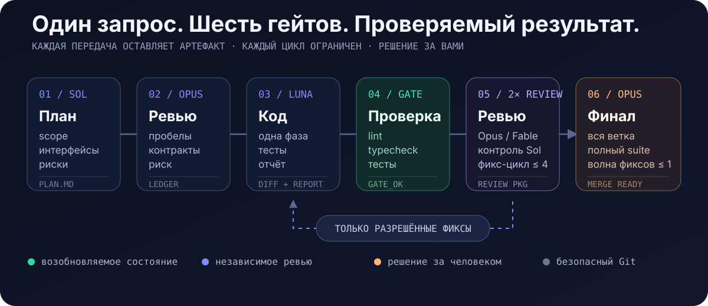

<p align="center">
  
</p>

<p align="center">
  <a href="./README.md"><strong>Read in English</strong></a>
  ·
  <a href="#быстрый-старт">Быстрый старт</a>
  ·
  <a href="#протокол-разработки">Протокол</a>
  ·
  <a href="#роли-моделей">Модели</a>
  ·
  <a href="#что-входит-в-плагин">Состав</a>
</p>

<p align="center">
  
  
  
</p>

`superpowers-strigov-ver` превращает Claude Code в структурированную систему разработки. Одна модель оркестрирует процесс, специализированные модели планируют и пишут код, независимые ревьюеры проверяют результат, а каждая важная передача оставляет долговечный артефакт.

> **Результат:** длинные задачи переживают compaction контекста, циклы ревью остаются ограниченными, а код не считается готовым, пока не пройдены гейты фазы и всей ветки.

## Быстрый старт

### 1. Установите зависимости

Нужны актуальный **Claude Code**, отдельный **Codex CLI** и однократный вход в Codex:

```bash
npm install -g @openai/codex
codex login
```

Codex нужен только встроенной схеме. Если аккаунта OpenAI нет, не ставьте его, но до первого запуска пайплайна назначьте свои профили всем ролям, во встроенной цепочке которых есть профиль Codex (`plan-reviewer`, `spec-reviewer`, `implementer`, `implementer.risk`, `implementer.escalation`, `control-review`, `final-review`, `adhoc-review`): см. [Маршрутизация ролей](#маршрутизация-ролей), пример для тех, у кого нет OpenAI. Тогда `agent-dispatch doctor` покажет неиспользуемые профили Codex как WARN, а не FAIL.

Необязательно — имплементер по умолчанию, **GLM-5.3-Flash через ZCode от Z.ai**: установите [ZCode](https://github.com/zai-org/ZCode) — macOS: ZCode.app в `/Applications`; Linux: см. [Linux: ZCode для канала GLM](#linux-zcode-для-канала-glm) ниже; Windows пока не поддерживается — и один раз сохраните API-ключ GLM Coding Plan со страницы <https://z.ai/manage-apikey/apikey-list>: выполните в терминале `zcode-dispatch api-key set` и вставьте ключ в скрытое приглашение. Ключ станет провайдером собственного шаблона ZCode «Z.ai Coding Plan» в приватном конфиге обёртки и не истекает. OAuth-входа нет: `zcode login` в CLI не хранит refresh-токен и живёт около часа (подробности — в скилле `zcode-invocation`, раздел «One-time setup»). Без ключа `zcode-dispatch doctor` не проходит, и пайплайн реализует фазы на Codex Luna `max` — с объявлением, никогда молча. За локальным прокси экспортируйте `ZCODE_HTTP_PROXY=http://<host>:<port>`, если фоновые запуски падают с сетевой ошибкой (CLI игнорирует `HTTP(S)_PROXY` и системный прокси macOS; обёртка передаёт эту переменную через белый список). CLI получает окружение по белому списку; дополнительные переменные можно явно передать через `ZCODE_ENV_PASSTHROUGH="NAME1,NAME2"`.

#### Linux: ZCode для канала GLM

У Z.ai есть официальная Linux-сборка ZCode (бета) на <https://zcode.z.ai> (раздел «All Downloads»: `.deb`, `.rpm` и `.AppImage` для x64 и ARM64). Пакеты `.deb` и `.rpm` ставятся в `/opt/ZCode` — именно там `zcode-dispatch` ищет ZCode по умолчанию. Проверено со всеми официальными пакетами 3.16.2 (CLI 0.17.0, одинаковый во всех шести): `.deb` на Debian 12 (arm64 и x64), `.rpm` на Fedora 42 и распакованный `.AppImage` (arm64). Во всех случаях `doctor` проходит, а пробный запрос доходит до Z.ai.

Шаги для вашего агента (Claude Code на Linux-машине):

1. Проверить зависимости: `node --version` (мажорная версия ≥ 26; обёртка запускает CLI системным `node`, а не Electron'ом приложения), `flock --version` (пакет util-linux, поставить, если нет), `git --version`.
2. Поставить ZCode. Сначала спросить пользователя: нужен sudo и скачивание около 170 МБ. Ссылку под архитектуру машины (`uname -m`: `x86_64` → x64, `aarch64` → ARM64) взять в разделе «All Downloads» на <https://zcode.z.ai>. Дальше:
   - Debian/Ubuntu: `sudo apt install ./ZCode-<версия>-linux-<arch>.deb`
   - Fedora/RHEL/openSUSE: `sudo dnf install ./ZCode-<версия>-linux-<arch>.rpm` (или `zypper install`)
   - Без sudo: скачать `.AppImage`, в выбранном каталоге выполнить `chmod +x ZCode-*.AppImage && ./ZCode-*.AppImage --appimage-extract` и прописать в `~/.claude/settings.json` `"env": { "ZCODE_APP": "<каталог>/squashfs-root" }`, чтобы этот путь видел каждый вызов `zcode-dispatch`. (Распаковка не требует ни FUSE, ни sudo. После неё должен существовать файл `squashfs-root/resources/glm/zcode.cjs`.)
3. Проверить. Ниже `<корень>` — это `/opt/ZCode` для `.deb`/`.rpm` или `<каталог>/squashfs-root` для AppImage. `doctor` нужен git-репозиторий, поэтому запускать его из репозитория, в котором будет работать пайплайн, или передавать `--cwd <репо>`:
   - `node <корень>/resources/glm/zcode.cjs --version` печатает версию CLI;
   - `zcode-dispatch doctor --cwd <репо>` показывает `ok platform: linux (config lock: flock(1))` и `ok app: <корень> <версия>`.

   На этом этапе падать могут только `personal-config` и `auth`: ключ ещё не сохранён. `WARN app-version` значит, что установленная версия отличается от той, на которой проверялась обёртка; это нормально, если проба на шаге 4 проходит. Если версию прочитать не удалось, `doctor` падает на `app`.
4. Шаг с API-ключом передать пользователю. Никогда не просить ключ в чате. Дать пользователю одну готовую команду для его терминала с абсолютным путём к `zcode-dispatch`. При установке из AppImage добавить префикс `ZCODE_APP=<корень>`, потому что его shell не видит `settings.json` Claude Code:

   ```
   /path/to/bin/zcode-dispatch api-key set                                              # .deb / .rpm
   ZCODE_APP=/home/<user>/apps/squashfs-root /path/to/bin/zcode-dispatch api-key set    # AppImage
   ```

   Пользователь запускает её и вставляет ключ в скрытое приглашение. После этого выполнить `zcode-dispatch doctor --probe --cwd <репо>` (один короткий запрос): `probe: ok` значит, что канал GLM работает.

Примечания:
- Пакет также кладёт в `PATH` команду `/usr/bin/zcode`. Это запуск десктопного приложения, а не CLI; обёртка её не использует.
- Не ставить сторонние пакеты ZCode CLI (например, `zcode-app-cli` из npm).
- За прокси экспортировать `ZCODE_HTTP_PROXY` (см. выше).
- Если официальный пакет не подходит (например, неподдерживаемый дистрибутив), можно скопировать `resources/{glm,config,app.asar}` из установки ZCode той же версии на macOS (`/Applications/ZCode.app/Contents/Resources`) или Windows в `/opt/ZCode/resources/`.

### 2. Установите плагин

Выполните в Claude Code:

```text
/plugin marketplace add strigov/strigov-cc-plugins
/plugin install superpowers-strigov-ver@strigov-cc-plugins
/reload-plugins
```

Companion runtime уже вендорится. Отдельный Claude Code-плагин OpenAI `codex-plugin-cc` **не нужен**.

### 3. Запустите реальную задачу

```text
/dev Реализуй возобновляемую загрузку файлов с проверкой целостности
```

Пайплайн не запускается самостоятельно. Запустите его командой `/dev` или сначала вызовите `/superpowers-strigov-ver:brainstorming`, чтобы согласовать дизайн. Чтобы продолжить незавершённый план в новой сессии, запустите `/dev` без задачи или просто попросите продолжить: тихий SessionStart-хук назовёт план. Внутри пайплайна `dev-orchestrator` выполняет триаж, а тривиальные правки одного файла идут по облегчённому пути Sonnet quickfix.

## Что меняется

| Обычный агентный процесс | Этот плагин |
|---|---|
| Одна модель планирует, пишет и сама оценивает свою работу | Каждый артефакт пишут и ревьюят разные модельные семейства |
| Прогресс живёт в основном в контексте чата | Планы, ledger, отчёты, diff и task ID позволяют возобновлять работу |
| Ревью может расширять scope или циклиться | Правила авторизации, детекторы churn и жёсткие лимиты ограничивают каждый цикл |
| Зелёная фаза может скрывать интеграционные ошибки | Финальное ревью всей ветки проверяет контракты и запускает полный suite |

## Протокол разработки

<p align="center">
  
</p>

1. **План** — Opus-субагент на `xhigh` исследует репозиторий и пишет долговечный план со scope, интерфейсами, глобальными ограничениями, тестами, рисками и явной меткой SECURITY/DATA_LOSS для каждой фазы.
2. **Критика** — свежее ревью Codex Astra `xhigh` ищет материальные пробелы, в том числе пропущенные метки риска; разрешённые правки уходят свежему Opus `high` через ledger.
3. **Реализация** — GLM-5.3-Flash `max` реализует одну фазу через собственный ZCode CLI от Z.ai и пишет отчёт. Codex Luna `max` подхватывает работу, если канал GLM недоступен или выключен; Sol 6.1 `xhigh` с самого начала реализует фазы с меткой SECURITY/DATA_LOSS и подхватывает работу, когда диагностика Opus, застрявший гейт или третий заблокированный раунд ревью требуют более глубокого reasoning.
4. **Верификация** — Sonnet-гейт на `medium` запускает lint, typecheck и затронутые тесты до начала дорогого ревью.
5. **Два ревью** — Opus `high` проверяет соответствие плану и качество (`xhigh` на фазах SECURITY/DATA_LOSS и в последнем раунде), затем свежий Codex Astra `high` ищет граничные случаи, гонки, уязвимости и регрессии.
6. **Гейт ветки** — после всех фаз свежий Opus `xhigh` проверяет всю ветку и полный набор тестов (Astra `xhigh`, если Opus недоступен). До финального вердикта разрешена одна объединённая волна фиксов.

Каждое продолжение имплементера адресуется по id через `--resume-task` — `task-…` для тредов Codex, `zt-…` для сессий ZCode. Ревьюеры получают сгенерированный пакет со списком коммитов, статистикой и контекстным diff, а не восстанавливают изменения из истории чата.

## Роли моделей

У каждой роли закреплена пара «модель + effort». Claude-субагенты получают явный `effort` в вызове Agent (без `ultrathink`); задачи Codex — явные `--model` и `--effort`.

| Роль | Модель · effort |
|---|---|
| Оркестратор (главный тред) | Claude Sonnet · `medium` |
| Автор плана / спеки | Claude Opus · `xhigh` |
| Ревизия плана и спеки | Claude Opus · `high` |
| Ревьюер плана и спеки | GPT-6 Astra · `xhigh` |
| Имплементер, fix-раунды, финальная волна фиксов | GLM-5.3-Flash · `max` через ZCode CLI от Z.ai |
| Резерв по доступности (GLM недоступен или выключен) | GPT-6 Luna · `max` |
| Фазы SECURITY/DATA_LOSS, эскалация reasoning | GPT-6.1 Sol · `xhigh` |
| Фронтенд-имплементер | Claude Opus · `high` (новый UI) / Claude Sonnet · `medium` (мелкие правки) |
| Основное ревью кода (4.1) | Claude Opus · `high`; `xhigh` на фазах SECURITY/DATA_LOSS и в раунде 4 |
| Контрольное ревью (4.2) | GPT-6 Astra · `high` |
| Финальное ревью ветки | Claude Opus · `xhigh`; GPT-6 Astra · `xhigh`, если Opus недоступен |
| Диагностика BLOCKED и застрявшего гейта, сводка по тупику (impasse) | Claude Opus · `high` |
| Гейт верификации, синтез, quickfix, integration check | Claude Sonnet · `medium` |

`max` зарезервирован за имплементерами GLM и Luna (или по явному запросу пользователя); `ultra` никогда не выбирается автоматически — только по явному запросу пользователя. Квота GLM: 2026-10-14 бонус 1.5× для ZCode по замеру не определён (ожидаемые/списанные кредиты = 3.02 по стандартному тарифу или 1.51, если окно пришлось на непиковые часы; подробности в docs/zcode-cli-findings.md).

Эта таблица — встроенная схема: без `config.json` работает ровно она. Любую роль, в том числе роли в сессии, можно переназначить на свой профиль — см. [Маршрутизация ролей](#маршрутизация-ролей).

## Свои харнессы и API

`bin/agent-dispatch` назначает ролям пайплайна **профили**. Профиль — это харнесс, способ оплаты (собственный вход харнесса или API-ключ), модель и effort. У роли **цепочка** профилей: первый — основной, остальные — запасные, по порядку. Без файла настроек ничего не меняется.

`agent-dispatch` — это слой маршрутизации (профили, ключи, `route`, `doctor`, статус задач, сквозной вызов ZCode и Codex) и адаптеры для `claude -p`, DeepSeek Harness (`dsh`), OpenCode и pi. Любую роль можно запустить на любом профиле, в том числе роли, которые по умолчанию исполняются в сессии.

`agent-dispatch` лежит в каталоге `bin/` плагина. В своём терминале вызывайте его по абсолютному пути — Claude подскажет его.

### Профиль за три шага

```bash
agent-dispatch preset list                                          # что можно скопировать
agent-dispatch profile add deepseek-claude --from claude-deepseek   # 1. профиль из пресета
agent-dispatch key set deepseek                                     # 2. ключ, скрытым вводом
agent-dispatch doctor --profile deepseek-claude --probe             # 3. проверки без модели + один короткий платный запрос
```

1. `profile add <имя> --from <пресет> [--model M] [--key K] [--set k=v]` копирует пресет в `config.json`. Если в пресете есть заполнитель `<…>`, его нужно заполнить флагом, иначе профиль не запишется.
2. Ключ вы кладёте сами, в своём терминале: `key set <имя>` запрашивает его скрытым вводом. Из сессии Claude Code ключ можно передать через pipe: `! pbpaste | agent-dispatch key set <имя>`, на Linux — `wl-paste` или `xclip -o -selection clipboard`. Ключ, переданный аргументом, отвергается. Профиль с `login` пользуется собственным входом харнесса. Для профиля с отдельным изолированным каталогом войдите в нём так: `agent-dispatch profile env <имя> -- <команда входа>` — `-- opencode auth login`, или `-- claude`, затем `/login`, или `-- pi`, затем `/login`.
3. `doctor --profile <имя>` проверяет всё, что можно проверить без вызова модели. `--probe` добавляет один короткий платный запрос на вашем ключе или подписке; его запускаете вы, пайплайн — никогда.

Все пресеты рассчитаны на `claude`, `dsh`, OpenCode или pi, а в 0.12.0 есть адаптеры всех четырёх, поэтому профиль из пресета готов к работе, как только проходит `doctor`. Профили на других харнессах пишутся вручную: другая модель или effort Codex либо другая модель Claude в сессии. Например, более дешёвое контрольное ревью и автор плана на Sonnet:

```json
{
  "version": 1,
  "profiles": {
    "astra-medium": { "harness": "codex",  "model": "gpt-6-astra", "effort": "medium" },
    "sonnet-high":  { "harness": "inproc", "model": "sonnet",      "effort": "high" }
  },
  "roles": {
    "control-review": ["astra-medium"],
    "plan-writer":    ["sonnet-high"]
  }
}
```

**Где это лежит.** Ваши профили и роли хранятся в `~/.claude/plugins/data/superpowers-strigov-ver-agents/config.json`. У каталога права 0700, а в файле нет секретов: ключи лежат в `keys/<имя>` с правами 0600.

- В файле обязательно поле `"version": 1`.
- Ваши профили добавляются к встроенным. Встроенные профили переопределить нельзя: `glm`, `luna`, `sol`, `astra`, `astra-high`, `opus-xhigh`, `opus-high` и `sonnet-medium`. Чтобы изменить такой профиль, скопируйте его под новым именем.
- Роль из файла, `"roles": { "<роль>": ["<профиль>", …] }`, целиком заменяет встроенную цепочку этой роли. Остальные роли остаются встроенными.
- Неизвестное поле или роль со ссылкой на несуществующий профиль отвергаются с их именем, так что опечатка вроде `efort` не пройдёт молча. О битом файле сообщает одна строка `config:`, и оркестратор задаёт вам один вопрос.

**Ключи из других мест.**

- По умолчанию (`{"key": "<имя>"}`) ключ читается из хранилища выше.
- Ключ, уже экспортированный в вашем шелле, передаётся только как `{"keyEnv": "VAR"}`. Без этого белый список окружения его срежет.
- Менеджер паролей подключается через `{"keyCmd": [...]}`:
  - macOS: `["security", "find-generic-password", "-w", "-s", "deepseek"]`
  - Linux: `["secret-tool", "lookup", "service", "deepseek"]`
  - любая ОС: `["op", "read", "op://…"]`

Диспетчер передаёт ключ через окружение процесса харнесса; сам он не подставляет его в argv, файлы настроек или промпты. Пайплайн никогда не запускает `key set` и не просит у вас ключ.

Диспетчер передаёт полученный ключ фоновому runner через анонимный канал в памяти, который runner закрывает до запуска харнесса. Файл передачи ключа в каталоге задачи не создаётся. Это не меняет необязательное хранилище `keys/<имя>` и описанную ниже видимость ключа внутри харнесса: Bash OpenCode и pi по-прежнему может прочитать его ключ.

Профили с общим ключом, общим входом харнесса (вход OpenCode или pi считается отдельно для каждого провайдера) или общей меткой `shares` выбывают вместе при `auth` или `quota`. У встроенного `glm` метка `zai-coding-plan`, поэтому запасной профиль с API Z.ai и той же меткой не упрётся в ту же исчерпанную квоту.

Каждый адаптер написан под одну версию харнесса. Сам Claude Code 2.1.302 запускался в ходе исследования, на локальных заглушках ([01](./docs/research/universal-dispatchers/01-claude-code-headless.md)); OpenCode, pi и dsh не запускались, их адаптеры написаны по исходникам и документации этих харнессов (`skills/agent-invocation`, «Facts from sources»). Ни один адаптер не запускался с настоящим провайдером: тесты идут только на заглушках, поэтому `doctor --probe` на вашем ключе — первая живая проверка. Другая версия допускается: `doctor` печатает одну строку «not checked» и запуск не блокирует. Исключение — OpenCode 2: у него другой CLI, и адаптер его отвергает (`launch`; см. [OpenCode](#opencode)). Подробно о харнессах: [docs/research/universal-dispatchers/](./docs/research/universal-dispatchers/) и [спецификация](./docs/superpowers/specs/2026-10-20-universal-dispatchers-design.md) (§2–§4).

### Claude Code (`claude -p`)

Установите сам Claude Code (`npm install -g @anthropic-ai/claude-code`); адаптер написан под 2.1.302.

| Чем платите | Пресет | Что важно |
|---|---|---|
| Подписка Claude (Pro/Max) | `claude-sub` (`opus`, `xhigh`) | Ваш собственный вход `claude`. Задачи тратят те же лимиты подписки, что и ваша основная сессия ([07 AN4](./docs/research/universal-dispatchers/07-tos-matrix.md)). Если `settings.json` в каталоге входа задаёт ключ, эндпоинт или `apiKeyHelper`, профиль отвергается (`doctor` FAIL `user-settings`). Второй аккаунт: `"home": "isolated"`, затем `agent-dispatch profile env <имя> -- claude` и `/login`. |
| API-ключ, Anthropic-совместимый эндпоинт | таблица ниже | `key set <имя ключа>`. Профиль работает в собственном каталоге конфигурации без входа claude.ai, ровно с одной переменной ключа. WebSearch и WebFetch запрещены. |
| Локальная модель | `claude-local` | Без ключа (`"auth": "none"`); см. ниже. |

Эндпоинты и рецепты окружения взяты из собственных инструкций провайдеров для Claude Code ([06 §1](./docs/research/universal-dispatchers/06-providers-and-plans.md)):

| Пресет | Имя ключа | `endpoint` | Модель | Окружение пресета |
|---|---|---|---|---|
| `claude-zai` | `zai` | `https://api.z.ai/api/anthropic` | `glm-5.3[1m]` | `API_TIMEOUT_MS=3000000`, `CLAUDE_CODE_AUTO_COMPACT_WINDOW=1000000`; `shares: zai-coding-plan` |
| `claude-deepseek` | `deepseek` | `https://api.deepseek.com/anthropic` | `deepseek-v4-pro[1m]` | `CLAUDE_CODE_AUTO_COMPACT_WINDOW=786432` |
| `claude-kimi` (Kimi Platform) | `kimi` | `https://api.moonshot.ai/anthropic` | `kimi-k3[1m]` | — |
| `claude-minimax` | `minimax` | `https://api.minimax.io/anthropic` | `MiniMax-M3.1-Flash[1m]` | `CLAUDE_CODE_AUTO_COMPACT_WINDOW=524288` |
| `claude-alibaba` (pay-as-you-go) | `alibaba` | `https://<WorkspaceId>.<region>.maas.aliyuncs.com/apps/anthropic`, `<region>` — один из `ap-southeast-1`, `us-east-1`, `eu-central-1`, `ap-northeast-1`, `cn-beijing` | `<model>`, например `qwen3.8-max` | эндпоинт задаётся через `--set endpoint=…` |
| `claude-openrouter` | `openrouter` | `https://openrouter.ai/api` | `<model>` | ключ Bearer, `ANTHROPIC_API_KEY=""` |

- `[1m]` сообщает Claude Code, что у модели окно 1M; для незнакомого id он считает 200K.
- Z.ai: на этом эндпоинте тариф определяется типом ключа (Coding Plan или Standard API) ([06 §1.3](./docs/research/universal-dispatchers/06-providers-and-plans.md)). `shares: zai-coding-plan` — для ключа Coding Plan, это квота встроенного `glm`; для ключа Standard уберите метку: `--set shares=`.
- Kimi Platform на Tier 0 пропускает один запрос за раз: добавьте `--set maxParallel=1`. `task` проверяет `maxParallel` у профилей claude, opencode, pi и dsh; у профиля codex или zcode его соблюдают только параллельные треки пайплайна, и не в роли профиля из `SP_IMPLEMENTER` (две отдельные сессии или ручные вызовы `task` тоже не учитываются).
- `effort` идёт в `--effort` и в `CLAUDE_CODE_EFFORT_LEVEL`; `CLAUDE_CODE_EFFORT_LEVEL` в `env` профиля (рецепты некоторых провайдеров ставят `max`) перекрывает поле `effort`.
- Опции: `options.tools` (набор инструментов пишущей роли, по умолчанию `Bash,Read,Edit,Write,Glob,Grep`), `options.settings` (сливается с `--settings` задачи), `options.maxTurns`.
- Ревьюер получает Read, Glob, Grep и команды только для чтения: `git show`, `git diff`, `git log`, `git status`. Ключ не доходит до Bash модели (`CLAUDE_CODE_SUBPROCESS_ENV_SCRUB=1`).

**Локальная модель.** `agent-dispatch profile add local --from claude-local --set endpoint=http://127.0.0.1:<порт> --model <id> --set env.CLAUDE_CODE_MAX_CONTEXT_TOKENS=<ctx>`, порт вашего сервера: llama-server 9931, LM Studio 1234, Ollama 11434 ([08 §3](./docs/research/universal-dispatchers/08-local-models.md)). Пресет запускает одну задачу за раз (`maxParallel: 1`), увеличивает тайм-ауты простоя потока Claude Code, чтобы их хватало на долгий prefill, и выключает блок атрибуции, который мешает серверу переиспользовать кэш промпта между задачами.

- `<ctx>` — контекст, который сервер реально даёт одному запросу (без этого `--set` остаётся значение пресета, 131072); `GET /props` у llama-server показывает `n_ctx` и число слотов. Чтобы поменять его позже, исправьте `env` профиля в `config.json`: `profile add` не перезаписывает существующее имя.
- У Ollama контекст по умолчанию 4k, если у видеокарты меньше 24 ГБ памяти, а всё, что не влезло, отбрасывается молча. Поднимите его через `OLLAMA_CONTEXT_LENGTH` (Ollama советует не меньше 64k для инструментов программирования).
- Память: на 16 ГБ локальная модель не годится в имплементеры; на 32–48 ГБ ей можно давать небольшие, хорошо описанные фазы. Никогда — фазы SECURITY/DATA_LOSS, планирование и блокирующее ревью ([08 §9](./docs/research/universal-dispatchers/08-local-models.md)). Маршрут задаётся ролью, а не фазой: отправить на один профиль только небольшие фазы нельзя, а `"implementer": ["local"]` (или `SP_IMPLEMENTER=local`) отдаёт локальной модели все фазы, раунды исправлений и финальную волну фиксов этой роли. Поэтому ставьте её последней в цепочке `implementer` — запасной, когда облачные каналы недоступны или исчерпали квоту, — или на `quickfix` (тривиальные правки одного файла). Никогда — первой в `implementer` и никогда — на `implementer.risk`, `implementer.escalation`, `plan-writer`, `plan-reviser`, `gate` или роль ревьюера.

### OpenCode

| | |
|---|---|
| Установка | `npm i -g opencode-ai@1.19.3` или `brew install anomalyco/tap/opencode`. Не `brew install opencode`: это OpenCode 2, адаптер его отвергает с подсказкой поставить v1. Поддерживается 1.19.x |
| Вход | Пресет `opencode-login` (`"auth": "login"`): `opencode auth login` → GitHub Copilot, ChatGPT Plus/Pro, OpenCode Go или GLM Coding Plan (провайдеры `github-copilot`, `openai`, `opencode-go`, `zai-coding-plan`); модель — `--model <provider>/<model>`. Вход GLM Coding Plan тратит квоту встроенного `glm`: добавьте `--set shares=zai-coding-plan`, чтобы профиль выбывал вместе с `glm` при `auth` или `quota` |
| Ключ | Пресет `opencode-key`: `--key <имя> --set keyVar=<VAR>`: `ZHIPU_API_KEY` для `zai-coding-plan`, `DEEPSEEK_API_KEY` для `deepseek`, `MINIMAX_API_KEY` для `minimax`. Ключ Coding Plan для `zai-coding-plan` тратит ту же квоту: добавьте и `--set shares=zai-coding-plan` (для ключа Standard — не нужно) |
| Модель, effort | `<provider>/<model>`, id из вывода `opencode models <provider>`; `effort` → `--variant` |
| Каталог | Профиль со входом использует ваши собственные каталоги OpenCode. Профиль с ключом получает свой, `homes/<профиль>/`, и в нём не должно быть сохранённого входа (`data/opencode/auth.json` перекрыл бы ключ: `doctor` FAIL, задача отвергается). Свой вход (второй аккаунт): `"home": "isolated"`, затем `agent-dispatch profile env <имя> -- opencode auth login`. При любой изоляции OpenCode читает ещё и `~/.opencode/opencode.json` и `opencode.jsonc` в вашем настоящем домашнем каталоге, а также те же два файла в управляемом каталоге настроек машины (`/Library/Application Support/opencode` на macOS, `/etc/opencode` на Linux). У профиля с ключом они читаются как JSONC (комментарии и висячие запятые допустимы), и проверяется запись `provider.<его провайдер>` (если `model` провайдера не называет — каждая запись): поле, которое перекрыло бы ключ или увело бы запросы на другой адрес, отклоняет профиль (`doctor` FAIL `home`, задача отвергается), и сообщение называет поле, но не его значение. Такие поля — любое поле записи, кроме `name`, `whitelist`, `blacklist`, `models` и `options` (`npm`, `api`, `env`, а также `id` или `doc`, оставшиеся от скопированной записи каталога); любой ключ `options`, кроме `timeout`, `chunkTimeout` и `setCacheKey` (`apiKey`, `baseURL`, `headers` и подобные); у модели в `models` — её `provider` и `headers`, а также `apiKey`, `baseURL` или `headers` в её `options` или `variants`. Безобидная запись (пустая, `name`, `whitelist`/`blacklist`, тайм-ауты, лимиты модели и варианты рассуждения) и файл без такой записи работают. Удалите поле. Перенести в `homes/<профиль>/config/opencode/opencode.json` можно только настройку без учётных данных (`baseURL`, `api`, `npm`): этот файл OpenCode тоже читает, и `apiKey`, заголовок или `env` там так же перекрыли бы ключ (ключ приходит через `keyVar`), а адаптер этот файл не проверяет. В управляемом каталоге это делает его администратор. Файл там, который не разбирается даже как JSONC или содержит ключ верхнего уровня с `{env:…}` или `{file:…}` (OpenCode подставляет их до разбора, и ключ может стать `provider`; сообщение называет ключ, а переменная и файл не читаются), проверить нельзя, поэтому он тоже отклоняет профиль; пустой файл (0 байт) OpenCode читает как `{}`, он пропускается. MDM-профиль macOS `ai.opencode.managed` не проверяется |
| Опции | `options.permission`: дополнительные правила разрешений OpenCode — для пишущей роли все, для ревьюера только `deny`. `options.plugins: true` загружает ваши внешние плагины OpenCode (по умолчанию выключены: `OPENCODE_PURE=1`) |
| Ревьюер | Собственный агент только на чтение: read, grep, glob, list и `git show/diff/log/status`. Ни правок, ни других команд, ни веба, ни файлов `.env`, ничего за пределами репозитория, кроме временных каталогов |
| Кто видит ключ | bash OpenCode его видит (см. [Песочницу](#песочница-по-желанию)); собственное хранилище сессий OpenCode сохраняет то, что напечатал его bash |

### pi

| | |
|---|---|
| Установка | `npm i -g --ignore-scripts @earendil-works/pi-coding-agent@1.3.0` (Node ≥ 22.19). Поддерживается 1.3.x. Поиску файлов и grep в pi нужны `fd` и `rg` в `PATH` (адаптер держит pi офлайн, поэтому pi их не скачает; `doctor` проверяет) |
| Ключ | Пресет `pi-key`: `--key <имя> --set keyVar=<VAR>`: `ZAI_API_KEY` для `zai`, `DEEPSEEK_API_KEY` для `deepseek`, `OPENROUTER_API_KEY` для `openrouter`. Модель `<provider>/<id>`; `effort` → `--thinking`. `zai` у pi — эндпоинт Coding Plan Z.ai: с ключом Coding Plan добавьте `--set shares=zai-coding-plan` (это квота встроенного `glm`), чтобы профиль выбывал вместе с `glm` при `auth` или `quota`; ключ Standard там оплачивается pay-as-you-go |
| Вход | «Sign in with ChatGPT»: `"auth": "login"`, затем `/login` в TUI pi (в вашем собственном каталоге pi или, с `"home": "isolated"`, через `agent-dispatch profile env <имя> -- pi`). Для входов pi в Anthropic и Copilot пресетов нет: там pi представляется другим клиентом |
| Каталог | Профиль с ключом работает в `homes/<профиль>/pi` (`agent-dispatch profile env <имя>` печатает его как `PI_CODING_AGENT_DIR`). Сохранённый там вход (`auth.json`) перекрыл бы ключ, поэтому профиль отвергается |
| Свой эндпоинт | `models.json` в этом каталоге с `apiKey` вида `"$<keyVar>"` или `"${<keyVar>}"`, чтобы ключ по-прежнему брался из хранилища. Любой другой `apiKey` там у провайдера профиля (у всех провайдеров, если `model` провайдера не называет) — ключ текстом, `!команда`, другая переменная — перекрыл бы `keyVar`: `task` отклоняет профиль (exit 2), а `doctor` даёт FAIL `pi-auth` (с `--probe` — до всякого запроса); так же — с `models.json`, который не разбирается как объект JSON или оказался символьной ссылкой. То же касается заголовка с учётными данными (`Authorization`, `x-api-key`, `api-key`, токен или секрет) в `headers` провайдера, в `models[].headers` или в `modelOverrides`: там допустимо только `"$<keyVar>"` / `"${<keyVar>}"`, можно после `Bearer `, а заголовок со значением `!команда` или другая переменная тоже отклоняется. Запись провайдера без `apiKey` работает. Формат: [03 §5.3](./docs/research/universal-dispatchers/03-pi.md) |
| Опции | `options.extensions`: по одному `-e` на элемент, например `["builtin:llama.cpp", "<путь>"]`; встроенные расширения pi — `builtin:mcp`, `builtin:llama.cpp`, `builtin:codemode`, `builtin:tool-search` |
| Ревьюер | `read,grep,find,ls` — **без bash, значит, без git**: diff он видит только в пакете ревью |
| Кто видит ключ | bash pi его видит (см. [Песочницу](#песочница-по-желанию)). Файлы сессии pi перезаписываются с вычищенным ключом, когда раннер завершает задачу: `completed`, `failed`, отмена или таймаут. Если погиб сам процесс раннера (его убили, сбой, отключение питания), задача помечается `failed` / `crash`, а эти файлы остаются невычищенными в закрытом (0700) каталоге данных, где лежит и хранилище ключей; чтобы их удалить, удалите каталог задачи `~/.claude/plugins/data/superpowers-strigov-ver-agents/state/<workspace>/jobs/<id>/` (`<workspace>` — имя папки рабочего дерева, где шла задача, дефис и 8 шестнадцатеричных цифр; у worktree параллельного трека, `<репозиторий>-wt-<фаза>`, — своё имя и свой счёт номеров задач). Продолженная задача держит файлы сессии в каталоге первой задачи своей цепочки, запущенной без `--resume-task`: удалите `jobs/<id>/` каждой задачи цепочки (id, переданные в `--resume-task`, до первой). Брать каталог из записи погибшей задачи нельзя: запись закрыта в том виде, в каком её оставила задача, а задача могла её переписать, в том числе `meta.sessionDir`. Пока это дерево существует, `agent-dispatch status <id задачи, которую она продолжила> --cwd <дерево> --json` показывает каталог цепочки — каталог над `job.meta.sessionDir`; это только подсказка, ведь и эту запись задача могла переписать, поэтому доверяйте ей, только если это `<этот каталог jobs>/<id задачи этой цепочки>/sessions` |

`models.json` для своего эндпоинта, при `"keyVar": "MY_KEY"` и `"model": "<provider>/<id>"` в профиле:

```json
{ "providers": { "<provider>": { "baseUrl": "<url>", "api": "openai-completions", "apiKey": "$MY_KEY", "models": [{ "id": "<id>" }] } } }
```

### DeepSeek Harness (`dsh`)

| | |
|---|---|
| Установка | `npm i -g @deepseek-ai/dsh@0.2.1-rc.2` (Node `^22.19` или `>=24`). `dsh` из Homebrew — другая программа, адаптер её отвергает. Поддерживается 0.2.x |
| Ключ | У DeepSeek нет подписки, у dsh нет входа. Пресет `dsh-deepseek`: `key set deepseek` (ключ идёт в `DEEPSEEK_API_KEY`). Либо `"auth": "native"`: `DEEPSEEK_API_KEY=…` в `$DSH_HOME/.env` (по умолчанию `~/.dsh/.env`) — но dsh сначала читает `.env` в репозитории, и ключ оттуда перекрывает ваш (`doctor` предупреждает) |
| Каталог | `"home": "user"` (по умолчанию): `$DSH_HOME` или `~/.dsh`. `"isolated"`: `homes/<профиль>/dsh` (`agent-dispatch profile env <имя>` печатает его `DSH_HOME`) |
| Модель, effort | `deepseek-v4-pro` (пресет) или `deepseek-flash` (умолчание самого dsh); effort `off`, `low`, `high` (по умолчанию) или `max` |
| Эндпоинт | `endpoint` — это `baseURL` dsh (по умолчанию `https://api.deepseek.com/anthropic`), например ваш собственный шлюз; `.env` репозитория его не меняет |
| Опции | `options.sessionLog: true` снова включает выгрузку журнала сессий dsh (по умолчанию выключена). `options.agentsHome: "user"` разрешает dsh читать общий `~/.agents`. `options.patch` добавляет строки в patch-файл dsh; переменная ключа, `baseURL` и строки разрешений остаются за адаптером |
| Ревьюер | Запрашивается песочница ОС dsh `read-only`. Перед каждым запуском ревьюера или пишущей роли с `native`, включая продолжение и probe, адаптер требует подтверждения разрешённых sandbox и approval policies в локальном `--dump-config`; несовместимые или неподтверждённые права блокируют запуск. Это проверка конфигурации, а не реализации песочницы ОС. Пишущая роль без `native` работает в `danger-full-access` |
| Кто видит ключ | dsh убирает переменные `*KEY*` и `*TOKEN*` из окружения своих инструментов |

### ZCode и Codex

- **ZCode** (`glm`): настройка — как в [Быстром старте](#1-установите-зависимости) и [Linux: ZCode для канала GLM](#linux-zcode-для-канала-glm). Профиль без изменений передаётся в `zcode-dispatch`; модель закрепляет обёртка.
- **Codex** (`luna`, `sol`, `astra`, `astra-high` и ваши профили `codex`): `codex login`, как в [Быстром старте](#1-установите-зависимости); профиль передаётся в `codex-dispatch`. Здесь описаны только модели OpenAI: сторонние провайдеры в собственной конфигурации Codex не описаны и не поддерживаются.

### Маршрутизация ролей

| Роль (имя в `config.json`) | Где в пайплайне | По умолчанию | Исполнение по умолчанию |
|---|---|---|---|
| `plan-writer` | автор плана | `opus-xhigh` | в сессии (Agent tool) |
| `plan-reviser` | правки плана | `opus-high` | в сессии |
| `plan-reviewer` | ревью плана (цикл до 4) | `astra` | внешний харнесс |
| `spec-reviewer` | ревью спецификации в brainstorming | `astra` | внешний харнесс |
| `implementer` | не-фронтенд фазы, fix, gate-fix, финальная волна фиксов, починка интеграции | `glm`, `luna` | внешний харнесс |
| `implementer.risk` | фазы SECURITY/DATA_LOSS | `sol` | внешний харнесс |
| `implementer.escalation` | эскалация на более глубокое рассуждение | `sol` | внешний харнесс |
| `frontend.new-ui` | фронтенд-фазы с новым UI | `opus-high` | в сессии |
| `frontend.tweak` | правки существующего фронтенда | `sonnet-medium` | в сессии |
| `gate` | lint, typecheck, затронутые тесты | `sonnet-medium` | в сессии |
| `phase-review` | ревью фазы 4.1 | `opus-high` | в сессии |
| `phase-review.escalated` | ревью фазы 4.1 на рисковых фазах и в раунде 4 | `opus-xhigh` | в сессии |
| `control-review` | контрольное ревью 4.2 | `astra-high` | внешний харнесс |
| `synthesis` | сводка ревью | `sonnet-medium` | в сессии |
| `final-review` | финальное ревью ветки | `opus-xhigh`, `astra` | в сессии, затем внешний харнесс |
| `diagnosis` | BLOCKED, застрявший гейт | `opus-high` | в сессии |
| `quickfix` | тривиальные правки | `sonnet-medium` | в сессии |
| `integration-check` | проверка интеграции параллельной группы | `sonnet-medium` | в сессии |
| `adhoc-review` | `requesting-code-review`, второе мнение в `systematic-debugging` | `astra-high` | внешний харнесс |

`frontend.new-ui` и `frontend.tweak` — две роли, а не цепочка: между ними, как и раньше, выбирает триаж.

Пример для тех, у кого нет OpenAI:

```json
"roles": {
  "implementer":            ["glm", "deepseek-dsh"],
  "implementer.risk":       ["claude-sub"],
  "implementer.escalation": ["claude-sub"],
  "plan-reviewer":          ["deepseek-claude", "oc-copilot"],
  "spec-reviewer":          ["deepseek-claude"],
  "control-review":         ["deepseek-claude", "glm-api"],
  "final-review":           ["opus-xhigh", "deepseek-claude"],
  "adhoc-review":           ["deepseek-claude"]
}
```

- При сбое GLM фаза уходит на `deepseek-dsh`, а не на Luna.
- Рисковые фазы и эскалации идут на Opus через подписку Claude.
- Ревьюеры работают на DeepSeek, а запасные — Copilot и API GLM.

Его профили создаются из пресетов выше; `deepseek-claude` — тот, что в разделе [Профиль за три шага](#профиль-за-три-шага):

```bash
agent-dispatch profile add deepseek-dsh --from dsh-deepseek   # тот же ключ deepseek
agent-dispatch profile add claude-sub   --from claude-sub
agent-dispatch profile add oc-copilot   --from opencode-login --model github-copilot/<model>   # id: opencode models github-copilot
agent-dispatch profile add glm-api      --from claude-zai     # key set zai
```

Ещё о маршрутизации:

- **Роли в сессии.** Их, как и остальные роли, можно назначить на любой профиль. Профиль `inproc` запускает их в сессии на другой модели или effort Claude: например, на Claude Pro можно задать `"sonnet-high": { "harness": "inproc", "model": "sonnet", "effort": "high" }` и `"plan-writer": ["sonnet-high"]`. Любой другой профиль запускает их фоновой задачей на своём харнессе. Роли, которые пишут файлы или запускают тесты проекта, получают право записи; гейт, ревью фаз и проверка интеграции всё равно не должны менять файлы — оркестратор сравнивает рабочее дерево до и после и один раз спрашивает вас, если что-то изменилось. `diagnosis` и `final-review` работают только на чтение. У ZCode (`glm`) режима только чтения нет: роль только для чтения там — эти две или ревьюер (`plan-reviewer`, `spec-reviewer`, `control-review`, `adhoc-review`) — получает право записи (`route` предупреждает) и проходит ту же проверку до и после; встроенные цепочки такую роль туда не ставят. На профиле с выключенной песочницей право записи — это полный доступ, как у имплементера ([Песочница](#песочница-по-желанию)), а проверка видит только рабочее дерево. Если тесты оставляют файлы, которых нет в `.gitignore`, добавьте их туда. На внешнем профиле `frontend.*` получает короткий бриф по дизайну вместо скилла `frontend-design`. Встроенные цепочки начинаются в сессии, поэтому без `config.json` ничего не меняется; `route --all` показывает каждую роль, чья цепочка отличается от встроенной, включая `"final-review": ["astra"]`.
- **Как пайплайн читает маршруты.**
  - При старте и после сжатия контекста оркестратор вызывает `agent-dispatch route --all`. Ответ `routes: default` не объявляется. Иначе вы получите одну строку с вашими отличиями.
  - Перед каждой отправкой ревьюеру или роли в сессии (автору плана, гейту, диагностике и остальным), при первой отправке фазы имплементеру и при каждой смене профиля он вызывает `route <роль>`, поэтому ничего не нужно помнить. Повторы и раунды исправлений фазы остаются на её текущем профиле.
  - После `routes: default` эти вызовы не делаются, и отвечает встроенная схема.
  - Переход на следующий профиль цепочки объявляется одной строкой, например `Channel implementer: glm-api → deepseek-dsh (glm-api: quota).` Переходы между встроенными профилями объявляются прежними строками, например `GLM channel failed … falls back to Luna max`.
- **Kill switch.**
  - «без GLM» и «через Luna» работают как раньше.
  - С вашей собственной маршрутизацией (`route --all` печатает не `routes: default`) фраза «без <профиль>» исключает любой профиль из всех цепочек до конца сессии; со встроенной схемой работают только «без GLM» и «через Luna», как раньше. В примере выше «без GLM» отправит все фазы, включая рисковые, на `deepseek-dsh`.
  - `SP_IMPLEMENTER=luna` работает как раньше. `SP_IMPLEMENTER=<профиль>` с профилем, который вы сами задали в `config.json` и который работает вне сессии, делает его имплементером для всех фаз, кроме фронтенда, и выключает GLM; если он упадёт, пайплайн спросит вас, а не перейдёт к другому профилю. `SP_IMPLEMENTER=glm` называет профиль по умолчанию и ничего не меняет. Любое другое значение, как и раньше, игнорируется: встроенное имя вроде `sol` (чтобы имплементером стал Sol, напишите в `config.json` `"implementer": ["sol"]`), неизвестное имя, профиль для сессии. GLM остаётся включённым. Если своих профилей у вас нет, пайплайн ничего не сообщает, а если есть — при старте выводит одну строку-предупреждение.
- **Правило семейств.** Во встроенной схеме автор и ревьюер артефакта принадлежат разным модельным семействам. `agent-dispatch` вашу маршрутизацию на это не проверяет. Ревьюер должен быть из другого семейства моделей, чем автор плана и имплементер.

### Песочница (по желанию)

`sandbox` и `wrap` есть только у профилей `claude`, `opencode`, `pi` и `dsh`; `doctor` проверяет оба поля. По умолчанию песочница выключена (`"sandbox": "off"`): пишущая роль тогда работает с полным доступом (claude `bypassPermissions`, dsh `danger-full-access`), как ZCode с `--mode yolo`.

| Харнесс | `"sandbox": "native"` |
|---|---|
| `claude` | Песочница Claude Code для Bash; пишущая роль работает с `acceptEdits` (правки только в репозитории). У Bash нет сети, пока вы не добавите домены в `sandbox.network.allowedDomains` через `options.settings`. Нужен `/usr/bin/sandbox-exec` на macOS, `bubblewrap` и `socat` на Linux |
| `dsh` | `workspace-write`: запись только в репозитории и во временных каталогах. В связанном git worktree (параллельный трек) `git commit` может быть запрещён, так как метаданные git лежат снаружи (не проверено); если так, не назначайте параллельные треки на dsh |
| `opencode`, `pi` | Своей песочницы нет: `native` ничего не делает (`doctor` так и пишет). Используйте `wrap` |

У профилей `codex` и `zcode` нет ни одного из этих полей (с ними `config.json` отклоняется): Codex всегда работает в своей песочнице — `workspace-write` с `--write`, только чтение без него; ZCode всегда работает с `--mode yolo`.

**`wrap`** — префикс argv для команды харнесса, например sandbox-runtime от Anthropic, `srt` (`@anthropic-ai/sandbox-runtime`, бета), или контейнер. Ставьте `srt` глобально (`npm i -g @anthropic-ai/sandbox-runtime`; Node ≥ 22.12, на Linux ещё `bwrap`, `socat`, `rg`) и никогда — внутрь репозитория, с которым работает пайплайн: копию там можно переписать изнутри песочницы. Профиль pi под `srt` и набросок его настроек ([09 §7.3](./docs/research/universal-dispatchers/09-sandboxing-and-credentials.md); не запускалось — полный список ключей в §2.3):

```json
"pi-deepseek": { "harness": "pi", "auth": { "key": "deepseek" }, "keyVar": "DEEPSEEK_API_KEY", "model": "deepseek/<id>",
                 "wrap": ["srt", "--settings", "/Users/me/.config/srt/pi.json", "--"] }
```

```json
{
  "network": { "allowedDomains": ["api.deepseek.com:443"], "strictAllowlist": true, "allowLocalBinding": false },
  "filesystem": {
    "denyRead": ["~/.ssh", "~/.aws", "~/.config/gh", "~/.config/gcloud", "~/.azure", "~/.kube", "~/.docker",
                 "~/.netrc", "~/.git-credentials", "~/.npmrc", "~/.pypirc", "~/.codex", "~/.zcode", "~/.pi", "~/.dsh",
                 "~/.local/share/opencode", "~/.claude", "~/.claude.json", "~/Library/Keychains"],
    "allowRead": ["~/.claude/plugins/data/superpowers-strigov-ver-agents/state",
                  "~/.claude/plugins/data/superpowers-strigov-ver-agents/homes/pi-deepseek"],
    "allowWrite": ["<repository>", "~/.claude/plugins/data/superpowers-strigov-ver-agents/state",
                   "~/.claude/plugins/data/superpowers-strigov-ver-agents/homes/pi-deepseek"]
  }
}
```

`allowRead` и `allowWrite` открывают в каталоге данных плагина только два места: `state/` (pi пишет файлы сессий в `state/<workspace>/jobs/<id>/sessions`) и каталог этого профиля `homes/<профиль>/`; остальное в `~/.claude` закрывает `denyRead`. Весь каталог данных открывать нельзя: в `keys/` лежат все сохранённые ключи, в каталогах других профилей — их входы, а задача, которая может писать в `config.json`, снимет свой `wrap` или добавит `keyCmd`, который выполнится вне песочницы. Ключ `agent-dispatch` читает вне песочницы и всегда так, как его называет `config.json`. Продолжение задачи идёт на профиле в том виде, в каком он сейчас записан в `config.json` (его `env`, `bin`, `wrap` и `sandbox`), а не на копии из записи задачи, и `--resume-task` отказывает (`dispatch --fresh`), если харнесс, модель, эндпоинт, каталог, `bin`, `wrap`, `sandbox`, `auth`, `keyVar` или `authHeader` в записи не совпадают с `config.json`. Поэтому задача, переписавшая свою запись, не снимет песочницу с продолжения своей сессии и не подсунет в него своё окружение (`NODE_OPTIONS`, `PATH`). Остаётся ограничение: в `state/` лежат и записи других задач, так что враждебная задача с правом записи туда может переписать запись ещё не стартовавшей задачи. Передача ключа больше не создаёт файл в этом общем каталоге. Считайте `srt` здесь защитой от небрежной модели, а не границей против враждебной.

Проверка no-edit до и после запуска использует Git-снимки и перечитывает присутствующие tracked-пути вопреки флагам `assume-unchanged` и `skip-worktree`, не меняя настоящий Git-индекс. Фильтры и нормализация Git сохраняются. Она не удостоверяет состояние staging index, refs, Git-конфига, ignored-файлов, `.superpowers/` и путей вне дерева. Границы доступа следует обеспечивать ограничениями файловой системы и сети.

- macOS не умеет вкладывать одну песочницу Seatbelt в другую. Под `srt` `claude` работает только с `"sandbox": "off"`, а `dsh` — только как пишущая роль без `native` (`danger-full-access`: его режим ревьюера тоже песочница).
- `srt` завершается с кодом 0, когда харнесс убит SIGINT или SIGTERM. Итог задачи берётся из её собственной записи, а не из этого кода.
- Локальной модели под `srt` нужны `"127.0.0.1:<порт>"` в `allowedDomains` и пустой `NO_PROXY` внутри песочницы: `srt` ставит `NO_PROXY=localhost,127.0.0.1,…`, а на macOS песочница видит loopback только на портах прокси `srt`. Например, закончите `wrap` на `"env", "NO_PROXY=", "no_proxy="`. Отправит ли после этого HTTP-клиент харнесса запрос к loopback по plain `http://` через прокси `srt`, не проверено ([09 §6](./docs/research/universal-dispatchers/09-sandboxing-and-credentials.md), правило 4; §10, пункт 5).
- На macOS держите `allowLocalBinding: false`. `true` открывает все порты localhost, включая локальный прокси (TUN- или VPN-клиента), и белый список выхода в сеть перестаёт действовать.
- `SANDBOX_RUNTIME=1` в окружении значит, что сам `agent-dispatch` уже работает внутри `srt` (например, в Bash Claude Code с песочницей): вложенный Seatbelt не запустится.
- Кто видит ключ: `claude` прячет его от Bash модели, `dsh` убирает из окружения своих инструментов, а bash OpenCode и pi его видит. Под `srt` `credentials.envVars` с `"mode": "mask"` (плюс экспериментальный `network.tlsTerminate`) отдаёт харнессу подставное значение; где утечка всё же возможна — [09 §2.4](./docs/research/universal-dispatchers/09-sandboxing-and-credentials.md).

### Что разрешают провайдеры — для справки, по состоянию на 2026-10-20; ответственность ваша

| Подписка / ключ | Разрешено официально | Серая зона | Не разрешено |
|---|---|---|---|
| Claude Pro/Max | Claude Code, включая `claude -p` [AN1, AN4] | — | OAuth в сторонних харнессах (OpenCode, pi и др.) |
| ChatGPT Plus/Pro | Codex; OpenCode, pi («Sign in with ChatGPT»), Kilo [OA1, OA6] | харнессы, которых OpenAI не называет | ChatGPT Business/Enterprise в сторонних харнессах |
| GLM Coding Plan | ZCode, Claude Code, Codex, OpenCode, pi, Crush, Kilo, Cline | — | инструменты, которых нет в списке Z.ai (Qwen Code, Kimi CLI, dsh) |
| GitHub Copilot | OpenCode [GH1] | Crush, Kilo, Cline | вход pi (pi представляется VS Code) |
| OpenCode Go | Claude Code, Codex, ZCode, pi, OpenCode, Kilo | — | — |
| OpenCode Zen | OpenCode | вне OpenCode | — |
| Kimi Code | интерактивная работа | неинтерактивный (headless) запуск (правила Kimi: «только интерактивно», хотя документация CLI показывает `kimi -p`) | — |
| MiniMax M Plan | любой совместимый инструмент | неинтерактивный (headless) запуск (подписка задумана для интерактивной работы) | — |
| Alibaba Coding Plan | интерактивная работа | — | неинтерактивный (headless) запуск [AL1] |
| Alibaba / QwenCloud Token Plan | — | неинтерактивный (headless) запуск | — |
| Google AI (Gemini, Antigravity) | инструменты Google | — | OAuth в сторонних харнессах; запуск `agy` из стороннего харнесса |
| Ollama Cloud | — | автоматизация (в условиях явно не разрешена) | — |
| Любой PAYG-ключ (DeepSeek, Z.ai Standard, Kimi Platform, MiniMax API, Alibaba PAYG, OpenRouter) | любой харнесс | — | — |
| Локальная модель | любой харнесс | — | — |

`claude -p` со сторонним эндпоинтом не нарушает условия Anthropic, но Anthropic такую конфигурацию не поддерживает.

ID источников в квадратных скобках ведут в [docs/research/universal-dispatchers/07-tos-matrix.md](./docs/research/universal-dispatchers/07-tos-matrix.md).

### Если что-то сломалось

Соберите три вещи и приложите их к issue или к сообщению владельцу:

- вывод `agent-dispatch doctor --profile <p>`;
- вывод `agent-dispatch status <id> --json`;
- лог задачи — `state/<workspace>/jobs/<id>.log` в каталоге данных выше. Секреты в нём вычищены.

Если эндпоинт отвергает beta-поля запроса, добавьте в `env` профиля `CLAUDE_CODE_DISABLE_EXPERIMENTAL_BETAS=1`.

## Защитные механизмы

- **Ручной запуск** — у pipeline-скиллов стоит `disable-model-invocation: true`: модель не видит их описания и не загружает их самостоятельно. Пайплайн запускается только по вашей команде, скиллы переходят друг к другу через чтение файлов `SKILL.md`, а незавершённый план возобновляется только по вашей просьбе. Discipline-скиллы (`systematic-debugging`, `test-driven-development`, `verification-before-completion`, `receiving-code-review`) по-прежнему включаются автоматически.
- **Независимое суждение** — автор и ревьюер артефакта принадлежат разным модельным семействам.
- **Authorization ledger** — замечания проходят триаж до передачи фиксеру; расширение scope не реализуется молча.
- **Ограниченные циклы** — ревью плана и фазы ограничено четырьмя раундами, финальное ревью ветки — двумя.
- **Без review ping-pong** — отклонённые замечания не возвращаются без нового основания, одинаковые списки блокеров эскалируются, а поздний малозначимый churn не может бесконечно удерживать цикл.
- **Власть человека** — конфликты с планом, материальное расширение scope и неразрешимые тупики возвращаются пользователю.
- **Безопасный Git** — без `--no-verify`, amend, force push и push без явного согласия в текущей сессии.
- **Изолированный параллелизм** — независимые фазы из плана могут идти в отдельных worktree с жёстким лимитом параллелизма два.
- **Доступ к GLM по правилам Z.ai** — GLM вызывается только через собственный ZCode CLI от Z.ai с честной идентификацией клиента; без прямого API и извлечения токенов; GLM никогда не получает фазы SECURITY / DATA_LOSS и работает без песочницы только внутри git-дерева под ограничениями преамбулы.

## Что входит в плагин

### Собственные возможности форка

| Компонент | Назначение |
|---|---|
| `dev-orchestrator` | Полный протокол планирования, реализации, верификации, ревью, коммитов и возобновления |
| `codex-invocation` | Надёжный фоновый dispatch Codex через вендорный companion runtime |
| `zcode-invocation` | Фоновый dispatch GLM-5.3-Flash через ZCode CLI от Z.ai: настройка, doctor/probe, цикл Monitor, обработка сбоев |
| `agent-invocation` | Маршрутизация ролей через профили `agent-dispatch`: `route`, задачи по префиксу id, классы сбоев, headless-преамбулы |
| `architecture-memory` | Компактная персистентная карта архитектуры в `docs/ARCHI.md` |
| `/dev` | Явная точка входа в полный протокол; без задачи — продолжение незавершённого плана |
| `bin/pipeline-context` | SessionStart-хук: называет незавершённый план и скилл, который нужно перечитать после компакции; в остальных случаях молчит |
| `bin/review-package` | Генерирует готовые для ревьюера пакеты коммитов и diff |
| `bin/sdd-workspace` | Резолвит изолированные scratch-workspace для каждого плана |
| `bin/zcode-dispatch` | Обёртка задач ZCode CLI: task/status/result/cancel/release-stale/doctor/api-key с закреплёнными моделью, режимом и идентификацией клиента; `release-stale` освобождает резервацию рабочего дерева, оставленную упавшей задачей, после проверки, что та мертва |
| `bin/agent-dispatch` | Профили, ключи и маршруты ролей (`route`, `channels`, `doctor`); один `status` по задачам ZCode, Codex и своим; сквозной вызов `zcode-dispatch` и `codex-dispatch` |

### Адаптированные скиллы Superpowers

`brainstorming`, `dispatching-parallel-agents`, `executing-plans`, `finishing-a-development-branch`, `receiving-code-review`, `requesting-code-review`, `systematic-debugging`, `test-driven-development`, `using-git-worktrees`, `verification-before-completion`, `writing-plans` и `writing-skills`.

Upstream-скилл `subagent-driven-development` заменён на `dev-orchestrator`. Агрессивная инъекция `using-superpowers` и её SessionStart-хук намеренно не включены; собственный SessionStart-хук плагина подаёт голос только при незавершённом плане или когда после компакции нужно перечитать скилл пайплайна.

<details>
<summary><strong>Карта репозитория</strong></summary>

```text
.
├── .claude-plugin/plugin.json       # Манифест и версия исходников
├── commands/dev.md                  # Точка входа команды /dev
├── hooks/hooks.json                 # SessionStart → bin/pipeline-context
├── bin/
│   ├── agent-dispatch               # Профили, ключи, маршруты ролей, отправка задач
│   ├── codex-dispatch               # Обёртка вендорного companion
│   ├── pipeline-context             # Незавершённый план / подсказка перечитать скилл
│   ├── review-package               # Генератор diff-пакета для ревьюеров
│   ├── sdd-workspace                # Резолвер scratch-workspace для плана
│   ├── zcode-dispatch               # Обёртка задач ZCode CLI (shim)
│   ├── lib/zcode-dispatch.mjs       # Раннер задач ZCode, записи, doctor
│   ├── lib/agent-core.mjs           # Общее ядро задач agent-dispatch
│   ├── lib/agent-dispatch.mjs       # CLI agent-dispatch, конфигурация, маршруты
│   ├── lib/agents-defaults.json     # Встроенные профили, роли, пресеты
│   └── lib/adapters/                # Адаптеры харнессов
├── skills/
│   ├── dev-orchestrator/            # Протокол и шаблоны промптов ролей
│   ├── agent-invocation/
│   ├── codex-invocation/
│   ├── zcode-invocation/
│   ├── architecture-memory/
│   └── ...                          # Адаптированные скиллы Superpowers
├── tests/test-sdd-scripts.sh        # Интеграционные тесты workspace/package
├── tests/test-pipeline-context.sh   # SessionStart-хук и проверки manual-only скиллов
├── tests/test-zcode-dispatch.sh     # Тесты обёртки ZCode (CLI-заглушка)
├── tests/test-agent-core.sh         # Тесты ядра задач (тривиальный адаптер)
├── tests/test-agent-dispatch.sh     # Тесты agent-dispatch (заглушки обёрток)
├── tests/test-adapter-*.sh          # Тесты адаптеров харнессов (заглушки харнессов)
├── tests/test-orchestrator-defaults.sh  # Встроенные роли, команды и лимиты не изменились
└── vendor/codex-companion/          # Вендорный companion runtime OpenAI
```

</details>

<details>
<summary><strong>Вендорный Codex companion</strong></summary>

Все вызовы Codex идут через `bin/codex-dispatch`. Обёртка работает из marketplace-установки или локального checkout и изолирует состояние в `~/.claude/plugins/data/superpowers-strigov-ver-codex`.

Upstream-база записана в `vendor/codex-companion/VERSION`. Локальные патчи добавляют адресный resume, reasoning-efforts `max`/`ultra` для GPT-6, очистку broker-процессов и необязательные поля авторизации ревью.

</details>

## Разработка и выпуски

Запуск тестовых suite:

```bash
bash tests/test-sdd-scripts.sh
bash tests/test-pipeline-context.sh
bash tests/test-zcode-dispatch.sh
bash tests/test-agent-core.sh
bash tests/test-agent-dispatch.sh
for t in claude opencode pi dsh; do bash tests/test-adapter-$t.sh; done
bash tests/test-orchestrator-defaults.sh
```

Для выпуска синхронизируйте версию в `.claude-plugin/plugin.json`, обоих README, `PLUGIN_README.md` и записи плагина во внешнем [каталоге marketplace `strigov-cc-plugins`](https://github.com/strigov/strigov-cc-plugins). Обновление только этого репозитория не публикует новую marketplace-версию.

## Происхождение

- [Superpowers](https://github.com/obra/superpowers) от Jesse Vincent / obra — MIT. Форк включает адаптированные скиллы v5.0.7 и отдельные, проверенные по исходникам механизмы Superpowers 6 v6.1.1.
- [TRIP-workflow](https://github.com/PiLastDigit/TRIP-workflow) от PiLastDigit — MIT. Отсюда адаптированы адресный resume, verification gate, синтез ревью, шаблон разовой консультации и концепция architecture memory.
- Вендорный Codex companion происходит из `codex-plugin-cc` OpenAI и сохраняет лицензию Apache-2.0.

## Лицензия

Оригинальная часть репозитория опубликована по [лицензии MIT](./LICENSE). Вендорные компоненты сохраняют свои лицензии.
